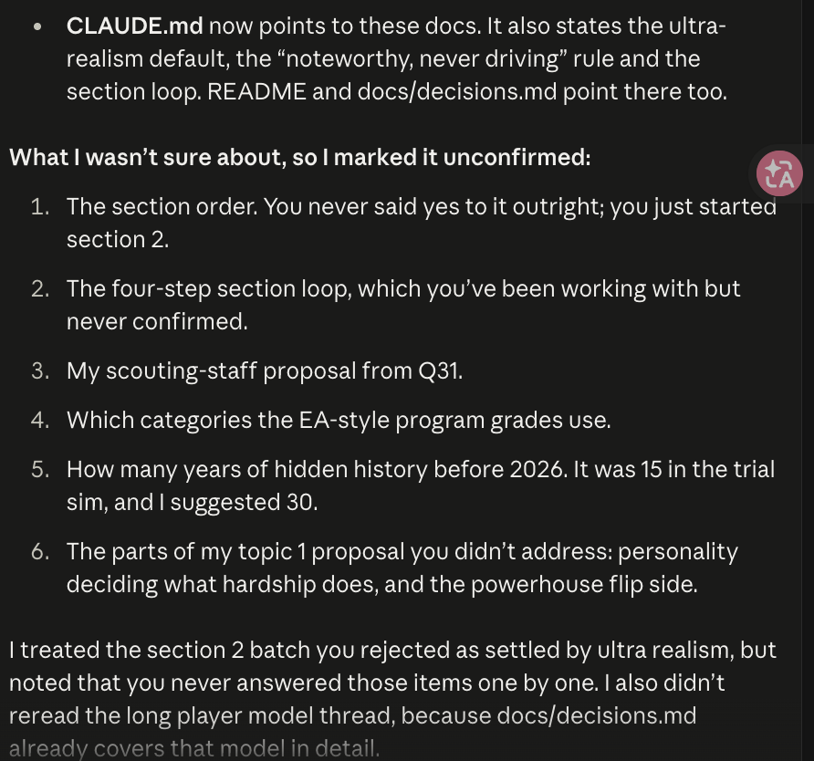

# 00 Project chat (the top-level timeline)

Every top-level message in the AFM project chat on the old account, oldest first, copied word for word on 2026-10-14. Replies inside threads are in the numbered files. Internal routing notices are kept so nothing is dropped.

### 2026-10-10 19:43:02 UTC · Claude
<sub>id cmsg_015NJfb6NRUve4Wa2buMtZKsMsin4cQX7aN6S6ngvGaHEY</sub>

{"first_name":"Raichel","kind":"onboarding","origin":"dialog","text":"Hi Raichel, welcome to your new project. I coordinate your work. Ask me a question or hand me a task, like researching a topic, drafting a doc, analyzing data, or fixing a bug, and I’ll either answer directly or start threads to work on it in parallel.\n\nThreads run on their own, and you can track them in Overview. I’ll post updates when something finishes or needs you.\n\nYou can also tell me how you’d like to work together. Change my instructions, connect your tools and files, set up scheduled updates, or ask for something else entirely."}

### 2026-10-10 19:43:15 UTC · Claude
<sub>id cmsg_015NJfb6NRUve4Wa2buMtZKs4poXnXnkd9PQGmMYkazcvd</sub>

*[thread_started]* {"kind": "thread_started", "thread_root_id": "cmsg_015NJfb6NRUve4Wa2buMtZKsJZ2Xgaq8DDrvue1N3VJuwN", "session_id": "cse_01LEmQd3y4SoycFTYBQdeC9p", "title": "Map AFM repo toward the football sim goal", "standalone": true, "text": "Created a thread."}

### 2026-10-10 19:43:15 UTC · Claude
<sub>id cmsg_015NJfb6NRUve4Wa2buMtZKsRKQTMANAaB8iZPfYZhz4dD</sub>

{"card_text":"Up to $100 of usage in the next 24 hours won't count toward your limits.","card_title":"Claude sets up your project automatically","detail_text":"Up to $100 of initial usage, including the automatic setup, won’t count towards your usage limits.\n\nValid for 24 hours after you create the project, or until the $100 is used up. After that, usage counts toward your limits as usual.","detail_title":"Claude sets up your project automatically","expires_at":"2026-10-11T19:43:13.845931+00:00","kind":"onboarding_grant","text":"Setup is on us. Up to $100 of usage in the next 24 hours won't count toward your limits.","ticket_label":"100 FREE"}

### 2026-10-10 19:43:20 UTC · Claude
<sub>id cmsg_015NJfb6NRUve4Wa2buMtZKs8QjdJyQaU4Uy9zp9YNJpSU · edited 2026-10-10T19:43:54Z</sub>

I recommend starting with this setup, drawn from your project goal and the AFM repository. The repository is still empty, so no code exists yet and every part of the game is open. The first choice is which technology to build on, and that question is waiting for you in [Map AFM repo toward the football sim goal](#cmsg_015NJfb6NRUve4Wa2buMtZKsJZ2Xgaq8DDrvue1N3VJuwN).

### 2026-10-10 19:44:00 UTC · Claude
<sub>id cmsg_015NJfb6NRUve4Wa2buMtZKs7qLnFoN3Ki8Xz167fLe12k</sub>

*[activity]* {"kind": "activity", "tool": "propose_project_setup", "text": "Proposed a setup for this project", "proposal": {"version": 1, "sessions": [{"title": "Build the player potential and development model", "prompt": "In the empty repo https://github.com/cnbville/AFM, scaffold a TypeScript project (default stack unless the user picked another in the exploration thread) and build the core player model: position-specific ratings, hidden and dynamic potential, age-based development curves, and progression across high school, college and NFL levels with realistic variance and setbacks. Include unit tests that simulate many careers and check the rating distributions look realistic. Open a draft PR. Done when the PR is up with green tests and a short summary of the development rules.", "description": "Potential, ageing and growth from high school to the NFL drive every other system.", "basis": "Exploration thread report: repo cnbville/AFM is empty; player model named as the foundation", "who": "claude", "produces": "pr"}, {"title": "Design the season calendar and pacing", "prompt": "Write a design doc for AFM, an American football management game modeled on Football Manager. Cover the full yearly calendar: high school and college seasons, recruiting, the combine, the NFL draft, free agency, training camp, preseason, regular season and playoffs. Explain how pacing builds tension slowly, what the player decides each week, and which events are allowed to be climaxes. Save it under /mnt/project-files/design/ and deliver it in the thread. Done when the doc covers the whole year week by week.", "description": "A patient, unhurried flow is central to the goal and shapes every screen.", "basis": "Exploration thread report: season flow listed as an unbuilt gap; project goal asks for a flow that doesn't rush climaxes", "who": "claude", "produces": "doc"}], "evidence": {"sessions_considered": 3, "window_days": 28}}}

### 2026-10-10 19:44:20 UTC · Claude
<sub>id cmsg_015NJfb6NRUve4Wa2buMtZKsMZ2BfFzrv5mkWNGZ4mzMJh</sub>

On it.

### 2026-10-10 19:44:22 UTC · Claude
<sub>id cmsg_015NJfb6NRUve4Wa2buMtZKsLF41YEMHX3KraUiuAb18CX</sub>

*[thread_started]* {"kind": "thread_started", "thread_root_id": "cmsg_015NJfb6NRUve4Wa2buMtZKs1pbtkM6b31NoTjktrjmMCU", "session_id": "cse_01JQgqp7rz4kKMexyFjLRnjv", "ack_message_id": "cmsg_015NJfb6NRUve4Wa2buMtZKsMZ2BfFzrv5mkWNGZ4mzMJh", "title": "Build the player potential and development model", "text": "Created a thread.", "setup_card_item": {"card_message_id": "cmsg_015NJfb6NRUve4Wa2buMtZKs7qLnFoN3Ki8Xz167fLe12k", "item_key": "session:0"}}

### 2026-10-10 19:44:23 UTC · Claude
<sub>id cmsg_015NJfb6NRUve4Wa2buMtZKs3M9NBUtPGend7B1NhogbLY</sub>

*[thread_started]* {"kind": "thread_started", "thread_root_id": "cmsg_015NJfb6NRUve4Wa2buMtZKsHAGmfyiYRFLtuiXu19z2Tv", "session_id": "cse_01RA5nJwD1qWN1TYVxrCxFXS", "ack_message_id": "cmsg_015NJfb6NRUve4Wa2buMtZKsMZ2BfFzrv5mkWNGZ4mzMJh", "title": "Design the season calendar and pacing", "text": "Created a thread.", "setup_card_item": {"card_message_id": "cmsg_015NJfb6NRUve4Wa2buMtZKs7qLnFoN3Ki8Xz167fLe12k", "item_key": "session:1"}}

### 2026-10-10 20:01:13 UTC · Raichel (member)
<sub>id cmsg_015NJfb6NRUve4Wa2buMtZKsLBVn665gXmKGxtMGwnHg33</sub>

I need you to calm down with the freestyling. I need you to run aspect through me because you're making a lot of decisions without me right now

### 2026-10-10 20:01:21 UTC · Claude
<sub>id cmsg_015NJfb6NRUve4Wa2buMtZKsPDPfJxDrfshE77LJfEeJ8n</sub>

*[System: message routed to a thread]*

### 2026-10-10 20:01:23 UTC · Claude
<sub>id cmsg_015NJfb6NRUve4Wa2buMtZKs7bysAax9TjHEwE615ayY73</sub>

*[System: message routed to a thread]*

### 2026-10-10 20:01:28 UTC · Claude
<sub>id cmsg_015NJfb6NRUve4Wa2buMtZKsFTmdcgjceJNaHZSpoUjATD · edited 2026-10-10T20:01:37Z</sub>

Understood, and sorry for getting ahead of you. I've paused the player model build. ~~Nothing gets pushed.~~ [Edit: it finished just before the pause arrived, see below.] The season doc stays a draft, and the stack is still open. From now on, each thread will bring you its decisions as short questions with options and wait for your answer.

### 2026-10-10 20:01:39 UTC · Claude
<sub>id cmsg_015NJfb6NRUve4Wa2buMtZKsSzULzijpuF3P1KFSUaPaXR</sub>

Correction: the player model thread finished before my pause reached it. It opened a draft pull request and pushed a one-file starter commit to main. Nothing is merged. The draft just sits there until you decide. That thread will now list its design choices for you to approve or change in [Build the player potential and development model](#cmsg_015NJfb6NRUve4Wa2buMtZKs1pbtkM6b31NoTjktrjmMCU).

### 2026-10-11 01:51:42 UTC · Claude
<sub>id cmsg_015NJfb6NRUve4Wa2buMtZKsT5vnqmtKYfK2uL5HeL4toG · edited 2026-10-11T05:10:05Z</sub>

{"code":"api_retrying","error_class":"rate_limited","kind":"error","limit_window":"five_hour","resolved":true,"scope":"thread","text":"A thread in this project was waiting on the usage limit of this account's Claude plan; that wait has ended.","thread_id":"cmsg_015NJfb6NRUve4Wa2buMtZKs1pbtkM6b31NoTjktrjmMCU","usage_limit":"true"}

### 2026-10-11 09:53:34 UTC · Raichel (member)
<sub>id cmsg_015NJfb6NRUve4Wa2buMtZKsC9z57BhccFN6HyZBkrPrG1</sub>

just messagfing to trigger session limit

### 2026-10-11 09:53:38 UTC · Claude
<sub>id cmsg_015NJfb6NRUve4Wa2buMtZKsMSsUZTK4QjWKjf1Wc2mH9P</sub>

Got it. While you're here: the bug fixes in [Build the player potential and development model](#cmsg_015NJfb6NRUve4Wa2buMtZKs1pbtkM6b31NoTjktrjmMCU) are done, and that thread now needs your answers on calls 1–7 before trial 5 can start.

### 2026-10-11 13:57:32 UTC · Raichel (member)
<sub>id cmsg_015NJfb6NRUve4Wa2buMtZKsL5GrufKTibAkwtqeqdKpN4</sub>

any way you can decrease the cache ? we're using a lot of tokens right now

### 2026-10-11 13:57:42 UTC · Claude
<sub>id cmsg_015NJfb6NRUve4Wa2buMtZKsCss5k9ntNx7w792EpVykqY</sub>

Yes, though I can't shrink the cache directly. I haven't measured it, but most of the usage is likely the player model thread. Its conversation is now very long, and every turn rereads all of it. Its trial checks also bring in several extra agents each time.

- **A (recommended):** do trial 5 in a fresh thread that starts from the saved notes and files, and use one checker instead of several.
- **B:** do A, and also run new threads on a smaller model. That's cheaper, but it's weaker at catching realism problems.
- **C:** keep things as they are.

Which do you want?

### 2026-10-11 13:58:13 UTC · Raichel (member)
<sub>id cmsg_015NJfb6NRUve4Wa2buMtZKs5fh1v9cKqDb9yVTDpoyaJN · attachments: trial6-fix-list.md; PR #2: player model and design docs <https://github.com/cnbville/AFM/pull/2> · 32 thread replies</sub>

Do trial 5 on a new thread

### 2026-10-11 13:58:29 UTC · Claude
<sub>id cmsg_015NJfb6NRUve4Wa2buMtZKsAMSN23Kf83EZKafwwziyqY</sub>

*[System: message routed to a thread]*

### 2026-10-11 13:58:39 UTC · Claude
<sub>id cmsg_015NJfb6NRUve4Wa2buMtZKs7sP6pqv37QMjBLiF4VgAzM</sub>

Sure, starting a fresh one.

### 2026-10-11 13:58:41 UTC · Claude
<sub>id cmsg_015NJfb6NRUve4Wa2buMtZKsHg7ScvQTtaThjjo4ZMazTJ</sub>

*[thread_started]* {"kind": "thread_started", "thread_root_id": "cmsg_015NJfb6NRUve4Wa2buMtZKs5fh1v9cKqDb9yVTDpoyaJN", "session_id": "cse_01MRmdzVaLb3F8SVDEtFUqDN", "ack_message_id": "cmsg_015NJfb6NRUve4Wa2buMtZKs7sP6pqv37QMjBLiF4VgAzM", "text": "Created a thread."}

### 2026-10-11 13:58:51 UTC · Claude
<sub>id cmsg_015NJfb6NRUve4Wa2buMtZKs2Tw9gNc47ZUHKBg319hjrV</sub>

The old thread is wrapping up: it's finishing the coachability fix and saving its code and notes, and the new one starts from those. Since you went with a new thread, I've also cut each trial to one check instead of several extra agents. Tell me if you'd rather keep the fuller checks.

### 2026-10-11 14:50:11 UTC · Claude
<sub>id cmsg_015NJfb6NRUve4Wa2buMtZKsAiEEsM97g3KFLsQ7yabQoE · edited 2026-10-11T17:46:31Z</sub>

**Trial 6 fix list (final).** These are the last fixes before the game itself; we debug from there. They're the fixes from your card review plus the calls and bugs you agreed to. We'll walk through them together before anything is built. The same list is in the repo at docs/design/trial6-fix-list.md on [PR #2](https://github.com/cnbville/AFM/pull/2).

1. **Career length by position, body and mind:** running backs age and retire earlier than other positions, while a rare long-lasting one like Derrick Henry stays possible. Quarterbacks who rely on their legs, like Jayden Daniels, decline faster than true pocket passers. Mental factors can also make a career longer or shorter (cards 1 and 5).
2. **Five-star busts:** scouts misjudging a player becomes a small extra cause, next to injury, work ethic, off-field trouble and maturing early (card 2).
3. **Dismissals by severity:** a serious cause drops the player a level or ends his career. A lesser cause moves him to a smaller FBS program, and the better the player, the more offers he gets (card 3).
4. **Fewer early cuts:** lower the odds that young draft picks get cut so soon. Cut players go to free agency or a practice squad and can sign again (card 6).
5. **Urgency to declare:** each player weighs how urgently he needs to turn pro.
   - Reasons to leave: little NIL at small schools, a running back's short shelf life, fear of falling off draft boards, his age, injury history, a coaching change, or losing his starting job.
   - Reasons to stay: big NIL money, or a chance to raise his draft stock (card 7).
6. **Camp and in-season form:** a strong preseason or stats above his rating can move a player up or down the roster. A 62 can make a badly run team (card 8).
7. **Calls and bugs you agreed to:**
   - Players arrive at college rawer, with a first-year dip that differs for each player (call 1).
   - Players declare early based on their draft projection (call 2).
   - Pro careers: no cuts that end a career, a free agency market, and safeties decline earlier (call 3).
   - Injuries cost games (call 4).
   - Depth charts have position slots (call 5).
   - Option C, the strict cutoff, for which players can get stars and FBS offers.
8. **Your extra notes on the calls:**
   - Leaving school weighs a bad final year, which team would draft him (Dante Moore and the Jets), and NIL money.
   - The draft landing spot matters. A bad team can stall a top pick (Darnold), and a better team later can revive him.
   - A tracked free agent pool where players can re-sign, and the same tracking for the college transfer portal.
   - Positional value plus team need, so a strong defense reaches for a generational CB or OLB (call 6).
   - Transfers can go sideways or down a level, not only up (call 7).

### 2026-10-11 15:02:36 UTC · Claude
<sub>id cmsg_015NJfb6NRUve4Wa2buMtZKsRfX9jr2QLugDvxzmFKK8X2 · edited 2026-10-11T17:20:02Z</sub>

{"code":"api_retrying","error_class":"rate_limited","kind":"error","limit_window":"five_hour","resolved":true,"text":"I was waiting here on the usage limit of this account's Claude plan; that wait has ended.","usage_limit":"true"}

### 2026-10-11 15:02:40 UTC · Claude
<sub>id cmsg_015NJfb6NRUve4Wa2buMtZKsQNXNYqoS2tELc94XX9QMHF · edited 2026-10-11T17:20:02Z</sub>

{"code":"api_retrying","error_class":"rate_limited","kind":"error","limit_window":"five_hour","resolved":true,"scope":"thread","text":"A thread in this project was waiting on the usage limit of this account's Claude plan; that wait has ended.","thread_id":"cmsg_015NJfb6NRUve4Wa2buMtZKs5fh1v9cKqDb9yVTDpoyaJN","usage_limit":"true"}

### 2026-10-11 17:22:12 UTC · Raichel (member)
<sub>id cmsg_015NJfb6NRUve4Wa2buMtZKsNN5gd4vTbpiAsmJjJ6d77t</sub>

we have to find a fix for this current token consumption. Single messeages cost 6% of my session

### 2026-10-11 17:22:21 UTC · Claude
<sub>id cmsg_015NJfb6NRUve4Wa2buMtZKsKgwXLCZWS4k8XXM38QhKDQ</sub>

Agreed. I can't see your usage meter, so this is my best read of the cause. Each message you send is handled by two Claudes: the thread Claude, whose conversation and loaded code have grown large again, and me, coordinating in the background. Both run on the biggest model, and both reread their whole context on every message.

What would help most:
- **A (recommended):** start trial 6 in a fresh thread from the fix list, and run threads on a smaller model (Sonnet). That's much cheaper per message, though a bit less sharp on realism checks.
- **B:** do only the fresh thread and keep the big model. This saves less.
- **Either way:** send feedback in one bundled message rather than several small ones. Each message costs a full turn, even a one-line message.

A or B?

### 2026-10-11 17:23:05 UTC · Raichel (member)
<sub>id cmsg_015NJfb6NRUve4Wa2buMtZKsFd4GuPZPWqNvrj45iHR29E</sub>

none because i've tried those alreeady and it still takes me 6% per message.

### 2026-10-11 17:23:16 UTC · Claude
<sub>id cmsg_015NJfb6NRUve4Wa2buMtZKsXNGUkLrkc5VF95GG9QtsWT</sub>

Understood, so those two levers aren't the cause. What's left is how projects work. Every message you send in a thread costs at least two Claude turns: the thread Claude answers, and I wake up for your message and again for its reply. A fresh thread or a smaller model doesn't change that, and from inside the project I can't switch it off.

Two things that would actually cut it:
- **A (recommended):** do the trial 6 build in one plain Claude Code session outside this project, so there's no coordinator. To make the code reachable there, the thread would first push it to a branch on your repo. Your earlier rule was to push nothing without your OK, so this would be that OK.
- **B:** stay here, and switch me and the threads to low effort. That means less thinking per turn, at some cost to depth.

A or B?

### 2026-10-11 17:24:59 UTC · Raichel (member)
<sub>id cmsg_015NJfb6NRUve4Wa2buMtZKsAGvBqWcyw5UMMwzdN63cTi</sub>

write a clear prompt to the thread to push all we currently have into the git, make sure the git holds all the info and content we discussed so it can be understood by agents that only have access to the git.

### 2026-10-11 17:25:15 UTC · Claude
<sub>id cmsg_015NJfb6NRUve4Wa2buMtZKsVYwcGDD4y1nzzU4Y79xEgc</sub>

*[System: message routed to a thread]*

### 2026-10-11 17:25:18 UTC · Claude
<sub>id cmsg_015NJfb6NRUve4Wa2buMtZKs1EZEave2ctcvXyPNSydj13</sub>

Sent. The [Trial 5 league sim](#cmsg_015NJfb6NRUve4Wa2buMtZKs5fh1v9cKqDb9yVTDpoyaJN) thread will push the code to a branch with the draft PR, not to main. It will also add a docs folder with every decision, the fix list and the trial data, plus a CLAUDE.md that tells any new agent your working rules and what to do next. It will reply there with the branch name.

### 2026-10-11 17:43:44 UTC · Raichel (member)
<sub>id cmsg_015NJfb6NRUve4Wa2buMtZKsF5hBznGBbGNrkXt7hirACX</sub>

I'm not seeing a clear overview of what we're trying to build ? an American football Manager simulator. I see the potential/projection. But not seeing a clear "this is what needs to be build"

### 2026-10-11 17:44:00 UTC · Claude
<sub>id cmsg_015NJfb6NRUve4Wa2buMtZKsT3PuaWSXGuEv8uB9QA6mBN</sub>

You're right. So far we've only built one engine, the player model, and there's no game around it yet. Here is my draft of the full picture, for you to change:

**Built (engine only, tested through trials):**
1. **Player model:** attributes, positions, potential, and development from high school through college to the NFL, plus stars, recruiting and the draft. Trial 6 finishes it.

**Still to build:**
2. **The world:** high school, college (FBS, FCS, D2) and NFL leagues, with teams, conferences and schedules.
3. **Clubs and staff:** owners, GMs, coaches and scouts, each with ratings (for example, drafting skill), plus budgets.
4. **Roster management:** depth charts, contracts, salary cap, free agency, practice squad, trades, NIL and the transfer portal.
5. **Match engine:** a play-by-play stat sim with play calling, schemes and injuries.
6. **Season flow:** camp, preseason, the season, playoffs, the draft and free agency, paced slowly. A draft doc exists.
7. **Screens:** player cards, team and stat screens, a news inbox, and the 2D play view with Next Gen Stats-style highlights.
8. **New game and saves:** setting up a career, then saving and loading it.

**Your call first:** what is the player in the game? An NFL GM or head coach, a college coach, or both? That decides the order of everything after it. My suggestion is an NFL GM first, with the first goal being one NFL season you can play in text.

Want this written into the repo as the roadmap once you've shaped it?

### 2026-10-11 17:45:43 UTC · Raichel (member)
<sub>id cmsg_015NJfb6NRUve4Wa2buMtZKs9dtfqTjUxp2vnqBLL9aKZr</sub>

okay so two things, we're still waiting on the final trial. Do you have access to the list i made manually ? and to the calls the Agent found themselves in trial 5 ?

### 2026-10-11 17:45:57 UTC · Claude
<sub>id cmsg_015NJfb6NRUve4Wa2buMtZKsGSeXGvQo3qqpCAkPmdGWBW</sub>

*[System: message routed to a thread]*

### 2026-10-11 17:46:02 UTC · Claude
<sub>id cmsg_015NJfb6NRUve4Wa2buMtZKsWZAuAtqjRr2cRtciMzJHjR</sub>

Yes to both, as far as I can tell. Your card notes are fixes 1 to 6 on the Trial 6 fix list. The calls and bugs the trial flagged are fix 7. Both are also in the repo, in docs/design/trial6-fix-list.md on PR #2.

I did spot one possible gap. The summary I got names calls 1 to 5, but not call 6 (teams reaching for a player at a position they need), call 7 (sideways transfers), or your extra notes on calls 2 and 3. I've asked [Trial 5 league sim](#cmsg_015NJfb6NRUve4Wa2buMtZKs5fh1v9cKqDb9yVTDpoyaJN) to check the file, add anything missing and push.

If the "list you made manually" is something other than your notes on the cards, I don't see it in the project files. Paste it here and I'll pass it on.

### 2026-10-11 17:47:09 UTC · Raichel (member)
<sub>id cmsg_015NJfb6NRUve4Wa2buMtZKsM1UvUqLtGyMCT9EXCjLkgV</sub>

be clearer, what you need from me right now before we can execute the final trial 6 ?

### 2026-10-11 17:47:14 UTC · Claude
<sub>id cmsg_015NJfb6NRUve4Wa2buMtZKsFMm4CKaaLdKBigcYd5qdDU</sub>

Three answers, and then trial 6 can start:

1. **Strict cutoff for stars and FBS offers (option C)?** Yes or no. Everything else on the list you've already approved.
2. **Build it now, or walk through the list first?** I recommend building now, since you've already agreed to every fix.
3. **Where should it run?** In the trial 5 thread here (recommended, because the code is already loaded), or in your own Claude Code session outside the project.

The roadmap question about what role you play in the game can wait until after trial 6.

### 2026-10-11 17:47:53 UTC · Raichel (member)
<sub>id cmsg_015NJfb6NRUve4Wa2buMtZKsSc8NQgZjE9TAic5Q2quKxr</sub>

Be more clear what you mean with 1.

### 2026-10-11 17:48:01 UTC · Claude
<sub>id cmsg_015NJfb6NRUve4Wa2buMtZKsUiYnD5PRLBZAhLdURNYpwV</sub>

**The problem:** right now, stars and FBS scholarships are based mostly on scouts' guesses about a player's upside, not on how well he actually plays. So a player can get three stars while ranking far down on his senior game film. Card 28 got three stars with 67,114 seniors ahead of him.

**The fix:** set a minimum film ranking among all seniors. Below it, a player can't get stars or an FBS offer. There are three options for how strict that line is:

- **A, loose:** three stars needs a top 5,000 ranking, two stars a top 12,000, and an FBS offer a top 10,000.
- **B, middle:** top 3,500, top 8,000 and top 6,500.
- **C, strict (recommended):** top 2,700, top 6,500 and top 4,500.

**Why C:** in the real NFL, about 19% of draft picks were two-star or unranked recruits. The sim gives 12% today, 7% with A, 8% with B and 12% with C. C stays closest to reality. A and B let FBS sign more unproven players, so fewer overlooked good players develop at FCS level and get drafted from there. The fix for rawer college arrivals, already on the list, should close the rest of the gap.

So the question is whether to go with C: yes or no?

### 2026-10-11 17:48:28 UTC · Raichel (member)
<sub>id cmsg_015NJfb6NRUve4Wa2buMtZKsBhi3bwUWBt4bbAiTYva7sQ</sub>

C

### 2026-10-11 17:48:31 UTC · Claude
<sub>id cmsg_015NJfb6NRUve4Wa2buMtZKsVjP2QRUNTMGVsG2Bt9ewoC</sub>

C is locked in. Two quick ones left:
2. Build now, or walk through the list first? Now is my recommendation.
3. Run it in the trial 5 thread here, or in your own session? Here is my recommendation.

### 2026-10-11 17:49:13 UTC · Raichel (member)
<sub>id cmsg_015NJfb6NRUve4Wa2buMtZKs2x9j5Z2yePU2Jisbm9YQMH</sub>

give me a clear overiew of the list as you have it so that i know everything is in there for the final build

### 2026-10-11 17:49:22 UTC · Claude
<sub>id cmsg_015NJfb6NRUve4Wa2buMtZKs1FiQBSp6As1CzH8XxbK71s</sub>

Here is everything on the trial 6 list. Tell me if anything is missing.

**Getting to college**
1. Stars and FBS offers need a minimum film ranking among seniors: option C, the strict one.
2. Players arrive at college rawer. Their first-year dip differs per player, depending on the size of the step up, position, polish, football IQ and makeup, physical readiness, and fit and luck.
3. Five-star busts happen after signing, from injury, work ethic, off-field trouble or maturing early. Scouts misjudging a player is a small extra cause.

**In college**
4. Dismissals depend on how serious the cause is. A serious cause drops the player a level or ends his career. A lesser one moves him to a smaller FBS school.
5. Transfers can go up, sideways or down a level, and the college transfer portal is tracked.

**Leaving for the draft**
6. Declaring early is based on draft projection plus urgency.
   - Reasons to leave: little NIL at small schools, a running back's short career, fear of falling off draft boards, age, injury history, a coaching change, or losing his starting job.
   - Reasons to stay: big NIL money, a chance to raise his stock, or a bad final year.
   - He also weighs which team would draft him (Dante Moore and the Jets).
7. Draft value depends on the position and on the team's needs, so a team with a strong defense reaches for a generational CB or OLB.
8. Where he lands matters. A bad team can stall a top pick (Darnold), and a better team later can revive him.

**In the pros**
9. Each player adjusts to the NFL at his own pace. Some, like Smith-Njigba and Nabers, are ready at once, and some UDFAs thrive.
10. Depth charts have position slots.
11. A strong camp, preseason or stats above his rating can move a player up or down the depth chart. A 62 can make the roster of a badly run team.
12. Fewer early cuts. Cut players go to a practice squad or free agency, and free agents can re-sign. No cuts that end a career.
13. Injuries cost games.
14. Career length depends on position, body and mind. Running backs and running QBs (Jayden Daniels) decline sooner, safeties earlier than now, and rare outliers like Derrick Henry last.

**Already done:** the coachability bug is fixed.
**On the cards:** each season will show the player's end-of-year level, so a big final year is visible.

### 2026-10-11 17:50:33 UTC · Raichel (member)
<sub>id cmsg_015NJfb6NRUve4Wa2buMtZKsJscytFCr5YgT7v3YLUapEK</sub>

does that include the bug fixes you found yourself in trial 5 ?

### 2026-10-11 17:50:42 UTC · Claude
<sub>id cmsg_015NJfb6NRUve4Wa2buMtZKs2NimYfE4nZPA1Zjnxa4n9U</sub>

Yes, with three additions. The 30-player trial found two bugs:
- Stars given on upside instead of film. This is item 1, option C.
- Coachability working backwards. This is already fixed.

These weren't written out as their own items, so I'm adding them now:

15. **Veterans start too long.** This was flagged on several cards. Younger players should win starting jobs through camp and form (item 11), and aging should weaken veterans sooner.
16. **Kickers and punters have no draft list of their own.** This was a partial bug left over from trial 4. Specialists get their own board, and they're drafted or signed like real kickers and punters.
17. **Some top-500 seniors still end up as two-stars** because scouts misread their film. This was the other leftover from trial 4. Item 2 (rawer arrivals) and item 1 should fix it, and trial 6 will check that.

That makes 17 items. Is that the complete list?

### 2026-10-11 17:53:57 UTC · Raichel (member)
<sub>id cmsg_015NJfb6NRUve4Wa2buMtZKsVPyon7H8EcgrV5pYT2KoMp · attachments: AFM Trial 6 <https://claude.ai/code/artifact/878257e4-b38b-4b24-8559-73dc2bbffb94>; PR #2 (merged) <https://github.com/cnbville/AFM/pull/2> · 2 thread replies</sub>

yes, now make a completely fresh thread, execute trial 6 on there for 20 players. Don't find/search calls/bugs, that's up to me to find out when eventually in gameplay. Make sure the thread gets all the context in at least as tokens as possible, make it read github instead of project if it's possible but also don't risk lesser quality by doing so, immediately push to git after you're done so there is no small message i need to respond to that eventually costs me a lot of tokens. First ask any clarifying questions, then push

### 2026-10-11 17:54:06 UTC · Claude
<sub>id cmsg_015NJfb6NRUve4Wa2buMtZKsGhYKzJzQ6yh8qcZWUCYR61</sub>

Three quick questions before I start it. Reply with three letters, for example "A A A".

1. **Which 20 players?**
   - **A (recommended):** 10 picked to cover every route (five-star, late bloomer, FCS, UDFA, dismissal, transfer and so on) and 10 random.
   - **B:** all 20 random.
2. **Where should you see the results?**
   - **A (recommended):** a new version of the same trial page, with a "why" box on each card, and the data also pushed to GitHub.
   - **B:** GitHub only.
3. **Where does the code go?**
   - **A (recommended):** pushed to the same branch as PR #2, with nothing merged into main.
   - **B:** merged into main.

The new thread will read everything from GitHub. Items 15 to 17 go into its brief, because they aren't in the repo yet. It will run at full quality, look for no new bugs, and send you just one message, when it's done and pushed.

### 2026-10-11 17:55:35 UTC · Raichel (member)
<sub>id cmsg_015NJfb6NRUve4Wa2buMtZKsGaPNeoNaytKCva9rAsHktQ</sub>

1. B random but realisitc scenarios that show the full range of possible outcomes
2. A
3. What difference would it make ? (genuine question)

### 2026-10-11 17:55:42 UTC · Claude
<sub>id cmsg_015NJfb6NRUve4Wa2buMtZKs3KQ941mnoStASDfNsJCr5s</sub>

Good question. "Main" is the official version of your project. It's what any new session sees first.

- **Branch only (A):** the work stays a draft until you approve it. The downside is that every new session has to be told which branch to use, or it will see an almost empty project.
- **Merge into main (B):** main holds everything, so any session you start later sees it straight away. The downside is that unapproved work becomes the official version. In a solo project that's low risk, and it can be undone.

Since you'll start new sessions outside this project, I now recommend B, merging into main once trial 6 is pushed. Reply A or B.

### 2026-10-11 17:56:18 UTC · Raichel (member)
<sub>id cmsg_015NJfb6NRUve4Wa2buMtZKsPi5P2YSpMzPYaEcPzViGTy</sub>

B

### 2026-10-11 17:56:40 UTC · Claude
<sub>id cmsg_015NJfb6NRUve4Wa2buMtZKsCvYVZT2fVgHcdkZXvvQnY9</sub>

Got it, kicking off trial 6 in a fresh thread.

### 2026-10-11 17:56:41 UTC · Claude
<sub>id cmsg_015NJfb6NRUve4Wa2buMtZKsK4pHEhoBFMhSZNMAB3Hrou</sub>

*[thread_started]* {"kind": "thread_started", "thread_root_id": "cmsg_015NJfb6NRUve4Wa2buMtZKsVPyon7H8EcgrV5pYT2KoMp", "session_id": "cse_015VBbu8bJa8eYssvn6d6xbK", "ack_message_id": "cmsg_015NJfb6NRUve4Wa2buMtZKsCvYVZT2fVgHcdkZXvvQnY9", "text": "Created a thread."}

### 2026-10-11 18:32:51 UTC · Raichel (member)
<sub>id cmsg_015NJfb6NRUve4Wa2buMtZKs7CQDYJ11UewTXknxDCcueW</sub>

while that is busy, let's work on the roadmap we need. What are your thoughts ?

### 2026-10-11 18:33:03 UTC · Claude
<sub>id cmsg_015NJfb6NRUve4Wa2buMtZKsSNmrHCi12WjjdcfLJQ5aV5</sub>

My thinking: aim for a first playable version as early as possible, and add depth after that. Roughly in this order:

1. **Foundations:** decide your role in the game, the platform (web or desktop), and the league setup. These are decisions only, no build.
2. **The world:** generated leagues, teams and staff, plus about 15 years of simulated history, so the game starts with a real past.
3. **Roster rules:** depth charts, contracts, the salary cap, free agency, and the draft as an event you play.
4. **Match engine and season loop:** plays simulated with stats, a weekly calendar, and the slow pacing.
5. **First playable:** one full NFL season, played through simple text screens. This is where you start debugging in gameplay.
6. **Screens:** player cards, team and stat pages, a news inbox, and the 2D replays in the Next Gen Stats style.
7. **Depth:** scouting trips, staff hiring, owner pressure, NIL, and later maybe a college mode.

**First decision: who are you in the game?**
- **A:** NFL GM only. You run the roster, draft and contracts, and the head coach runs game day.
- **B:** NFL head coach only. You run game plans and play calls, and the GM controls the roster.
- **C (recommended):** both, the way a Football Manager manager handles both transfers and tactics. It's the closest to FM, and the deepest.
- **D:** college head coach, with recruiting and NIL at the core.

I'm changing my earlier suggestion from GM only to C, because C mirrors the game you're modeling. Which one?

### 2026-10-11 18:34:39 UTC · Raichel (member)
<sub>id cmsg_015NJfb6NRUve4Wa2buMtZKsC8Yr1W4aRcnoZSRiUS7BLJ</sub>

Give me 50 clarifying questions, in order that will eventaully build a clear roadmoap. THen we'll divide that in sections and start building in order, agreed ?

### 2026-10-11 18:35:19 UTC · Claude
<sub>id cmsg_015NJfb6NRUve4Wa2buMtZKsN7hSy9jRTtPHKjzzUKVAB6</sub>

*[widget]* {"kind": "widget", "family": "card", "widget": "writing_draft_v0", "input": {"body": "## 1. You and the game\n1. Your role: A GM only, B head coach only, **C both, like FM (rec)**, D college coach\n2. Can you be fired and hired by another team, like FM? **A yes (rec)**, B no\n3. Start: **A pick any team, plus an optional unemployed start (rec)**, B weak teams only\n4. College coaching later: **A NFL only for the first version (rec)**, B both from the start\n5. Team names: **A real cities with made-up nicknames, which avoids licensing (rec)**, B real names, C fully fictional\n6. **A single player (rec)**, B online leagues later\n7. **A one realistic mode (rec)**, B difficulty levels\n8. Your background (ex-player, scout, coordinator) sets your starting reputation: **A yes (rec)**, B no\n\n## 2. The world\n9. Leagues: **A NFL in full detail, with college and high school in less detail (rec)**, B NFL and FBS only\n10. NFL structure: **A real 32 teams, conferences and divisions (rec)**, B other\n11. Schedule: **A real 17 games, a bye week and a 14-team playoff (rec)**\n12. Rule changes and expansion over the years: **A not in the first version (rec)**, B yes\n13. UFL or CFL as landing spots for cut players: **A yes, as simple pools (rec)**, B no\n14. Warm-up history with records, a Hall of Fame and past champions: **A yes (rec)**, B no\n15. AI teams trade with you and with each other, using real logic: **A yes (rec)**, B no\n16. Owners selling or relocating teams: **A not in the first version (rec)**, B yes\n\n## 3. Players\n17. You sign off on the 35-40 attribute list before the game build: **A yes (rec)**\n18. What you see: **A ranges that sharpen with scout quality, FM-style (rec)**, B exact numbers\n19. Personality (leadership, greed, loyalty, temper) affects contracts and the locker room: **A yes (rec)**, B no\n20. Morale and team chemistry: **A yes, simple at first (rec)**, B no\n21. Off-field events (holdouts, arrests, media): **A yes, rare (rec)**, B no\n\n## 4. Roster and money\n22. Salary cap: **A real rules (dead money, restructures, franchise tag), added in steps (rec)**, B simplified\n23. Contract talks through agents with personalities: **A yes (rec)**, B direct\n24. Rookie wage scale by pick: **A yes (rec)**\n25. Trades with current and future draft picks: **A yes (rec)**\n26. 53-man roster, practice squad and IR rules: **A yes (rec)**\n27. Money: **A owner-set budgets only (rec)**, B full club finances (tickets, revenue)\n28. Facilities that affect development: **A yes, in a later phase (rec)**, B no\n\n## 5. Staff\n29. Hire coordinators, position coaches, scouts and trainers, each with ratings: **A yes (rec)**\n30. Schemes (for example 3-4 or 4-3) change how well players fit: **A yes (rec)**\n31. Other teams can poach your staff: **A yes (rec)**\n\n## 6. Draft and scouting\n32. Send scouts to regions and players, with reports that improve over time: **A yes (rec)**\n33. Combine and pro days with measurables: **A yes (rec)**\n34. Live draft day with trades: **A yes (rec)**\n35. UDFA signing rush after the draft: **A yes (rec)**\n\n## 7. Game day\n36. Your control: **A set the game plan, with optional live play calling (rec)**, B game plan only, C call every play\n37. Every play simulated with player positions and routes, which the 2D view needs: **A yes (rec)**\n38. Playbook: **A preset schemes with adjustable tendencies (rec)**, B full playbook editor\n39. Halftime adjustments, timeouts and fourth-down calls: **A yes (rec)**\n40. Weather, home field and travel effects: **A yes, modest (rec)**\n41. In-game injuries with return estimates: **A yes (rec)**\n42. One game takes: **A 10-15 minutes with highlights, or instant (rec)**, B other\n\n## 8. Season flow\n43. A new game starts mid-February, right after the Super Bowl: **A yes (rec)**, B other\n44. Weekly training focus: **A per unit plus individual focus (rec)**, B per unit only\n45. **A news inbox now, press conferences later (rec)**, B both now\n\n## 9. Screens\n46. Look: **A FM-style dense tables with a modern finish (rec)**, B minimal and clean\n47. Player card: ratings, level rating, potential (original vs boosted) and career history. Anything else?\n48. Stats: **A a full play-by-play database with advanced stats (EPA, CPOE) (rec)**, B box scores only\n\n## 10. Tech and first target\n49. Platform: **A web browser, the easiest to test and share (rec)**, B desktop app, C both later\n50. First playable: **A one NFL season, on text screens, as GM and head coach (rec)**, B other\n", "title": "AFM roadmap: 50 questions", "scenario_summary": "Answer with a letter, or your own words. (rec) marks my recommendation. Leave a line blank to accept the recommendation."}, "text": "Agreed. Here are the 50 roadmap questions in build order. Answer them in the draft and send it back.", "by_channel_session": true}

### 2026-10-11 18:35:56 UTC · Raichel (member)
<sub>id cmsg_015NJfb6NRUve4Wa2buMtZKsRFLvNTin5Fm34x9bp2bqW9</sub>

? what are you doing, chaotic message you send me

### 2026-10-11 18:36:03 UTC · Claude
<sub>id cmsg_015NJfb6NRUve4Wa2buMtZKsDHM78YUfvy1mCFh9wdfHus</sub>

Sorry, that card was a mess. Let's do it in batches of 10 instead. Reply with ten letters, like "C A A A A A A A B A". My pick is in brackets.

**Batch 1 of 5: you and the world**
1. Your role: A GM, B head coach, C both like FM, D college coach (C)
2. Can you get fired and join another team? A yes, B no (A)
3. Start: A pick any team, B weak teams only (A)
4. First version: A NFL only, B NFL and college coaching (A)
5. Team names: A real cities with made-up nicknames, B real names, C fully fictional (A)
6. A single player, B online leagues later (A)
7. A one realistic mode, B difficulty levels (A)
8. Your background (ex-player, scout) sets your starting reputation: A yes, B no (A)
9. Simulated leagues: A NFL in full, with college and high school in less detail, B NFL and FBS only (A)
10. NFL setup: A real 32 teams, 17 games, 14-team playoff, B other (A)

### 2026-10-11 18:42:37 UTC · Raichel (member)
<sub>id cmsg_015NJfb6NRUve4Wa2buMtZKsMM61QRKEea2qMmn1pYYUdQ</sub>

1. C
2. Absolutely, the game starts in 2026 then could go on for 50 years if needed, switching teams
3. Any teams, again it's based on real life and a comprehensive simulation game.
4. NFL for now, leave room for updates
5. A, realistic names
6. FOr now it's just meant for me personally on my computer, no itention of releasing it as an steam game 
7. One realistic mode
8. Yes, changeble starting stats
9. All 3 with extreme detail, i want every part to matter, stats in highschool should translate to NFL (i mean this nuanced)
10. A, -> same goes for FBS, FCS, D2 they should all have real life aspects.


make sure the questions in batch 2 take these answers into account

### 2026-10-11 18:43:07 UTC · Claude
<sub>id cmsg_015NJfb6NRUve4Wa2buMtZKsETEAtZ1z6HyWBTQKTyYUJ9</sub>

Got it, all saved. Batch 2 is about the world in detail and the players. Reply with ten letters, my pick in brackets.

11. College names: since the game is only for you, A real schools and conferences (Alabama, SEC), B made-up, like the NFL (A)
12. High schools: A real towns with generated schools, B fully made-up (A)
13. High school games: A every school plays full simulated games, which is slowest, B full games for strong programs and stat seasons for the rest (A, to match "extreme detail")
14. Stats at every level come from the same match engine, adjusted for opponent strength, so high school numbers really carry forward: A yes, B no (A)
15. Real rules at each level: NCAA eligibility, the four-game redshirt rule, scholarship and roster limits, D2 partial scholarships, NIL and portal windows: A yes, B simplified (A)
16. Real calendar at each level: high school season, signing days, portal windows, bowls, combine, draft: A yes, B simplified (A)
17. Recruiting geography with real talent hotbeds (Texas, Florida, Georgia, California): A yes, B no (A)
18. What you see of players: A rating ranges that get sharper the better your scouts are, like FM, B exact numbers (A)
19. Personality (leadership, greed, loyalty, temper) affects contracts, the locker room and development: A yes, B no (A)
20. Your own manager ratings (motivating, tactics, judging talent) grow over your career, like FM: A yes, B no (A)

### 2026-10-11 18:50:04 UTC · Raichel (member)
<sub>id cmsg_015NJfb6NRUve4Wa2buMtZKsKudhnfpaKUkcUosLGKQTeM</sub>

11. I changed my mind, i want NFL to have real names too, but add an toggle when starting new game that allows you to choose before you start a save
12. A
13. A
14. A
15. A
16. A
17. A
18. A -> add an small hint/tip when you have high scouting skills. For example if a smaller edge in HS has a High QB pressure rate and the GM's scouting skills are high, he gets a small hint "this player is probably gonna grow in size or a hint that says the opposite"
19. Absolutely 10000% yes, ultra-realism
20. Yes.

### 2026-10-11 18:50:25 UTC · Claude
<sub>id cmsg_015NJfb6NRUve4Wa2buMtZKsWd5gYbthGFi45ouoyrduAW</sub>

Saved, including the scouting hints and the real names with a toggle at new game. Batch 3 covers the locker room, money and staff. My pick is in brackets.

21. Off-field events like holdouts, arrests and media drama, driven by personality: A yes, rare, B no (A)
22. Morale and chemistry (playing time, contract unhappiness, team leaders): A yes, B no (A)
23. Salary cap: A full real rules (dead money, restructures, franchise tag, rollover), B simplified (A)
24. Contracts negotiated through agents with their own personalities: A yes, B directly with the player (A)
25. Rookie wage scale by pick, plus the fifth-year option: A yes, B no (A)
26. Trades with current and future picks, and AI teams trading with each other: A yes, B no (A)
27. Roster rules (90 in the offseason, 53 active, practice squad, IR): A yes, B simplified (A)
28. Money: A owner budgets for staff, scouting and facilities now, with full club finances later, B full finances from the start (A)
29. Staff (coordinators, position coaches, scouts, trainers, medical), each rated, with an effect on development, injuries and scouting: A yes, B no (A)
30. Schemes (3-4 vs 4-3, West Coast vs Air Raid) change which players fit and what they're worth to you: A yes, B no (A)

### 2026-10-11 18:51:08 UTC · Raichel (member)
<sub>id cmsg_015NJfb6NRUve4Wa2buMtZKs2NPxpAxNuEKyUQJLrpsWso</sub>

yes to all

### 2026-10-11 18:51:17 UTC · Claude
<sub>id cmsg_015NJfb6NRUve4Wa2buMtZKsNUCw4YhikF7CzJJA3uK7py</sub>

Noted. Batch 4 covers scouting, the draft and game day. My pick is in brackets.

31. Scouts assigned to regions, conferences or single players, with reports that get better over time: A yes, B no (A)
32. Combine, pro days and private workouts with real measurables (40-yard dash, bench, vertical, shuttle): A yes, B no (A)
33. Live draft day: you pick on the clock and can trade up or down, and AI teams trade too: A yes, B no (A)
34. A rush to sign undrafted free agents right after the draft: A yes, B no (A)
35. Your control on game day: A set the game plan and call plays live whenever you want, B game plan only, C every single play (A)
36. Playbook: A real schemes with tendencies you can adjust (run-pass mix, blitz rate), B a full editor where you draw plays (A)
37. In-game decisions (halftime adjustments, timeouts, fourth downs, two-point tries), with optional analytics advice from your staff: A yes, B no (A)
38. Weather, home field, altitude, travel and short weeks affect play: A yes, modestly, B no (A)
39. In-game injuries, with your medical staff estimating return dates: A yes, B no (A)
40. Game length: A your choice each game, either 10-15 minutes watching highlights or an instant result, B always full (A)

### 2026-10-11 19:07:28 UTC · Raichel (member)
<sub>id cmsg_015NJfb6NRUve4Wa2buMtZKsXUC3pC4DVyb7XdNV3HSY5G</sub>

31. A yes but i'm curious what you think scouting as an NFL GM/HC is right now ? how do you currently treat it.
32. A) Yes but with insane detail, did the player show up early or  late, are his parents loudmouths that yell at every game or are they social media happy ?  how did he seem to the scouts ? 
33. A
34. A
35. A
36. A
37. A
38. A
39. A
40. Game time on paper should always be 15 minutes, when live play calling it's play by play

### 2026-10-11 19:07:47 UTC · Claude
<sub>id cmsg_015NJfb6NRUve4Wa2buMtZKsS7H5rywSz6HKxwx2tZa21U</sub>

**How scouting works right now (Q31):** it only exists inside the sim. Each high school senior gets three film reports with random error, averaged into his stars. Upside is one shared guess, which misses more often. Each NFL team grades its draft board once, and how accurate the board is depends on the GM's and owner's drafting skill. You can't scout anything yourself yet.

**What I'd build for you as GM and head coach:**
- A scouting staff: a director, area scouts and cross-checkers.
- You assign them to regions, conferences or single players.
- Every report has error that shrinks with the scout's skill and with how much he has seen: film, live games, workouts and interviews.
- Your draft board is built only from your own reports, never from true ratings. AI teams build theirs the same way, with their own errors.
- Pro scouting works the same way for free agents and trades.
- Character reports (Q32) feed each player's hidden personality: did he show up early or late, are his parents loud at games or busy on social media, how did he come across to scouts.

**Q40:** I've noted it as about 15 minutes to watch a game, and play by play when you call plays live.

**Batch 5, the last one.** My pick is in brackets.

41. A new save starts mid-February, right after the Super Bowl: A yes, B at training camp (A)
42. Weekly training focus per unit, plus an individual plan for each player: A yes, B units only (A)
43. Media: A a news inbox now, with press conferences and player talks later, B all of it now (A)
44. Owner goals and job security (expectations, patience): A yes, B no (A)
45. Look: A dense tables like FM with a modern finish, B minimal (A)
46. Player card: ratings, level rating, original vs boosted potential, career stats, scout hints and character report. Anything to add?
47. A full play-by-play stats database with advanced stats (EPA, CPOE, pressure rate) at every level: A yes, B box scores only (A)
48. History: Hall of Fame, awards (MVP, Heisman, All-American) and record books: A yes, B no (A)
49. Platform: A runs in your browser on your own computer, the simplest to build, B a standalone desktop app (A)
50. First playable: A one NFL season on text screens as GM and head coach, with high school and college simulated around it, B other (A)

### 2026-10-11 19:19:07 UTC · Raichel (member)
<sub>id cmsg_015NJfb6NRUve4Wa2buMtZKsSQfhZ7wmAky1wGvWH1p1Rb</sub>

41. A
42. A
43. A
44. A
45. A
46. Potential should pretty much be hidden, like the suggestion i gave earlier the better your scouting you'll receive small important hints and i agree there should be a small idea of potential but i absolutely don't want the "this is the players ceiling exactly" that defeats the entire point of the game and is also what i mentioned in the beginning. This is extremely pivotal to understand
47. Yes, i want every possible stat, i want to be an huge stat nerd
48. yes
49. Whatever allows me to run the most realistic dense game engine (discuss your answer with me first)
50. i don't understand what you mean

### 2026-10-11 19:19:24 UTC · Claude
<sub>id cmsg_015NJfb6NRUve4Wa2buMtZKsPxa6zfLSqSk7um286twKDw</sub>

Noted on 41 to 45, 47 and 48.

**46, potential:** understood, and it's pivotal. The true ceiling stays hidden in the game. You only get a vague sense of it, like "could become a starter", plus small hints, and both get sharper and more trustworthy the better your scouts are. One thing to flag: an earlier decision said the screen shows original versus boosted potential. I'll limit that to our test pages, never the game itself. Tell me if that's wrong.

**49, platform:** this is the trade-off as I see it.
- **A, browser:** easiest to build, but limited memory and speed. Fifty years with every high school game simulated would choke it. Not recommended.
- **B, desktop app with an engine in Rust, a very fast language (recommended):** maximum speed on all your processor cores, and huge save files in a local database. Football Manager itself runs on a fast native engine. The cost is that we rewrite the existing player model from TypeScript into Rust once. It's already designed and tested, so this is mostly translation.
- **C, desktop app that keeps the current TypeScript code:** no rewrite and decent speed, but several times slower than B once the world gets big.

**50, first playable:** I mean the first point where you can actually open the game and play. My suggestion is that you start a save, pick a team and play one full NFL season as GM and head coach: offseason, draft, games and playoffs. It runs on simple text screens, with high school and college simulated in the background. The nice screens and the 2D view come after that.

So I need two answers: 49 (A, B or C) and 50 (does that first milestone sound right, yes or no?).

### 2026-10-11 19:26:55 UTC · Raichel (member)
<sub>id cmsg_015NJfb6NRUve4Wa2buMtZKs2sFCdLpmTWQPYRsf56GPMD · 2 thread replies</sub>

46. agreed.  49. Okay you can rewrite into rust, do this in a new thread and immeidately push to git to make sure everything is updated and we can continue with the actual roadmap and game. 50. Still don't understand why you need a different first season ? or are you suggesting to do that so that the rest of the world can set up ?

### 2026-10-11 19:27:12 UTC · Claude
<sub>id cmsg_015NJfb6NRUve4Wa2buMtZKsUm6HHztF5reHi97y4oi19q</sub>

Starting the Rust rewrite now.

### 2026-10-11 19:27:13 UTC · Claude
<sub>id cmsg_015NJfb6NRUve4Wa2buMtZKs52M4UfKyX48wcQt3ujS82J</sub>

*[thread_started]* {"kind": "thread_started", "thread_root_id": "cmsg_015NJfb6NRUve4Wa2buMtZKs2sFCdLpmTWQPYRsf56GPMD", "session_id": "cse_014avbKjX5MZyt6rEcJEuDLK", "ack_message_id": "cmsg_015NJfb6NRUve4Wa2buMtZKsUm6HHztF5reHi97y4oi19q", "text": "Created a thread."}

### 2026-10-11 19:27:14 UTC · Claude
<sub>id cmsg_015NJfb6NRUve4Wa2buMtZKsNoEygwW5YVH5r9o6akpUsn</sub>

On 50: no, it isn't a different season. "First playable" just means the first version of the game you can actually open and play: you start a career in 2026 and play your first season with your team. Before that, the world sets itself up in the background, running about 15 years of hidden history so rosters, records and college programs look real on day one. The nicer screens and the 2D view get added on top of that same game afterwards. So it's a building milestone, not a separate mode.

### 2026-10-11 19:27:39 UTC · Raichel (member)
<sub>id cmsg_015NJfb6NRUve4Wa2buMtZKsPmmig7sy5acpEbwyNWYAq5</sub>

then i'm still really confused why you ask me that in a seperate questuon

### 2026-10-11 19:27:43 UTC · Claude
<sub>id cmsg_015NJfb6NRUve4Wa2buMtZKs3NEhAFvwXCapg3SJsBa8JE</sub>

Fair, I worded it badly. It's really a question about build order:

- **A (recommended):** get the game playable early with plain screens, then add depth and polish while you play and debug.
- **B:** build everything first, including the nice screens and the 2D view, and only then start playing.

A lets you find problems in gameplay sooner, which is how you said you want to debug. A or B?

### 2026-10-11 19:28:08 UTC · Raichel (member)
<sub>id cmsg_015NJfb6NRUve4Wa2buMtZKs3NcJRhQLzeWHKm77Lz5LvP</sub>

Ahhhh okay, damn bruh you had me confused.. hahhahah yeah A. Smart

### 2026-10-11 19:28:21 UTC · Claude
<sub>id cmsg_015NJfb6NRUve4Wa2buMtZKsQ6xXDpC2t7w1Rq1fuGr7ty</sub>

Haha, my bad. All 50 are answered now. Here's the roadmap they add up to, in build order:

1. **Engine in Rust:** running now.
2. **The world:** real NFL, college and conference data, real towns with generated high schools, staff, the name toggle, and the 15-year hidden history.
3. **Match engine:** every game at every level simulated play by play, with injuries, weather and the full stats database.
4. **Calendar:** the whole year for all three levels, including games, signing days, the portal, bowls, the combine, the draft and free agency.
5. **Team management:** roster limits, depth charts, contracts and the cap, agents, trades, free agency and the practice squad.
6. **People:** personality, morale, off-field events, rated staff and hiring, owner goals and job security, and your own manager profile.
7. **Scouting and draft:** your scouts, reports with hidden potential and hints, character reports, the combine, the live draft and the undrafted rush.
8. **First playable:** new game setup, saves and plain text screens. You start playing and debugging here.
9. **Game day control:** game plans, live play calling, in-game decisions and staff analytics.
10. **Screens:** dense FM-style screens, player cards, the inbox, history, awards and records, and the 2D Next Gen Stats replays.
11. **Later:** press conferences, full club finances and a college coaching mode.

Does this order work for you? Once you say yes and the Rust rewrite has landed, I'll write it into the repo and start section 2.

### 2026-10-11 19:31:57 UTC · Raichel (member)
<sub>id cmsg_015NJfb6NRUve4Wa2buMtZKs2shaL5zynLCfGTaEmURuKG</sub>

Okay so i understand i ask you for 50  questions so you can't get much detail in just 50 but obviously i want waaaaay more control of the details for example in the training aspect i see sooooo much realism, potential in there.


so while the engine is running I wan't to discuss the rest of the roadmap, what is the plan immeidately after the engine tranlation is done

### 2026-10-11 19:32:15 UTC · Claude
<sub>id cmsg_015NJfb6NRUve4Wa2buMtZKsHG7D7ySjAaqDmtpWNk31Xw</sub>

Agreed, 50 questions only set the outline. **Here's the plan:** every section gets its own design rounds with you before anything is built, as many batches as it takes. Each section goes through the same loop:
1. Design questions with you, until the details are nailed down.
2. The answers get written into the repo as that section's spec.
3. A fresh thread builds it, merges it, and sends you one message.
4. A short trial with a "why" on every result.

Training gets its own section, after "People", so it gets the depth you're describing.

**Right after the Rust port** comes section 2, the world. We can do its design rounds now, while the port runs. Batch 1, my pick in brackets:

1. High schools: A all of the roughly 14,000 real programs, B the roughly 4,000 that produce almost every college player (A, Rust can handle it)
2. Real state classifications (6A, 5A and so on) and state playoffs: A yes, B no (A)
3. Each high school has its own coaching quality, facilities, scheme, tradition, and pipelines to certain colleges: A yes, B no (A)
4. Colleges: A every FBS, FCS and D2 school, with D3 and NAIA as simple pools, B FBS and FCS only (A)
5. College programs have budgets, NIL collective strength, facilities, prestige, academic standards and a recruiting footprint: A yes, B no (A)
6. Conference realignment over the decades: A occasional and realistic, B conferences stay fixed (A)
7. A coaching carousel in college and the NFL, with firings, coordinators moving up and coaching trees: A yes, B no (A)
8. NFL franchises have owner personality, market size, stadium and fan patience: A yes, B no (A)
9. Where talent comes from shifts slowly by state over the decades: A yes, B fixed (A)
10. Hidden history before 2026: A 15 years, which is faster, B 30 years, for deeper records and Hall of Fame classes (B)

### 2026-10-11 19:35:29 UTC · Raichel (member)
<sub>id cmsg_015NJfb6NRUve4Wa2buMtZKs3RxC9wVxXXwHnjmVsJuQKw</sub>

so i'm noticing you ask me a lot of questions that you already know the answer too, i've told you multiple times i want yltra realism so your questions are arbitrary. 

Instead of "oh should i use realistic schools bullshit," lets talk about the ranking of coaches, if a school is in a crime/low income zone how does that effect as opposed to a matter dei. That's the real shit i want to. get into. So rewrite your questions for section 2 with that in mind... capiche ?

### 2026-10-11 19:36:04 UTC · Claude
<sub>id cmsg_015NJfb6NRUve4Wa2buMtZKs6SY6nrGqezbr1CX6w8UqNo</sub>

Capiche. Ultra realism is the default from now on, and I'll only ask about how things actually work. For each question below I give how I'd build it. Tell me what's wrong or missing.

**1. Neighborhood and income.** A kid in a low-income or high-crime area gets worse nutrition (slower physical growth), no private trainers or 7v7 circuit (fewer chances to be seen), more off-field and family risk, and more eligibility trouble from grades. A Mater Dei kid gets all of that support, but sometimes a smaller, more established role on a stacked roster. Question: should hardship also be able to build drive and toughness, or does that turn into a cliché? I'd make it a possible effect, never a guaranteed one.

**2. Powerhouses pulling talent.** Places like Mater Dei, IMG and Duncanville actively recruit transfers from other schools and states. That leaves weaker home teams, and some kids reclassify or go to prep school. Agree?

**3. How coaches are ranked.** Each coach has hidden true ability and a public reputation, and reputation lags reality. That makes overrated and underrated coaches possible. True ability splits into teaching each position group, scheme knowledge, game management, motivation, discipline, recruiting and player relationships.

**4. Exposure.** A great kid at a tiny rural school in Montana gets far fewer looks than a Texas 6A starter. Camps, 7v7, highlight tapes and a coach with college connections raise how visible he is. That's how real hidden gems exist.

**5. Family.** Parents shape him through stability, money, education and athletic genes (a former pro's son gets a frame and early football IQ). Family also pushes his decisions on NIL, transfers and declaring for the draft.

**6. The JUCO route.** Players who fail academically or were overlooked go to junior college and can come back up to FBS, like Cam Newton. This is new, since we never discussed it. Add it?

**7. College prestige.** Prestige is built from history, recent winning, the coach, facilities and NIL money. History moves it slowly, but one hire or a bag of NIL can spike it fast, like Deion at Colorado.

**8. NIL and tampering.** Rich boosters create bidding wars, and agents tamper with players before the portal opens. How dark do you want it? I'd include tampering, with the risk of NCAA punishment.

### 2026-10-11 19:38:13 UTC · Raichel (member)
<sub>id cmsg_015NJfb6NRUve4Wa2buMtZKsUYo5pnK86ymSpNw3125eXv</sub>

Let's go into detail on 1.

### 2026-10-11 19:38:24 UTC · Claude
<sub>id cmsg_015NJfb6NRUve4Wa2buMtZKsLp2JcKTJakc98RNmRXy42B</sub>

Here's how I'd build it. Every player grows up with a hidden background made of six parts. Each one moves different things, and personality decides how much it bites.

**1. Household money.** Affects nutrition, so how much of his frame he fills out by 17. Also whether he can pay for trainers, camps and travel ball. Poor kids reach their ceiling later, often in college, which makes them natural late bloomers.

**2. Neighborhood safety.** Raises the risk of off-field incidents, injuries outside football, and losing friends or family. A coach or mentor who keeps him busy can cancel most of this.

**3. Family structure.** Two parents, a single parent, raised by grandparents, or foster care. This sets how steady his grades and discipline are. It also decides who influences his choices: a parent chasing NIL money pushes him differently than one focused on school.

**4. School resources.** Weight room, coaching staff size, film tools, academic support. A Mater Dei kid trains like a college player at 15. A kid at a poor school often learns technique late, so he arrives at college raw but with untapped upside.

**5. Exposure network.** Does his coach know college coaches, and does he play 7v7 or attend camps? This decides whether scouts find him at all.

**6. Academics.** Grades decide whether he's eligible. Failing pushes him to junior college or prep school, or out of football.

**How personality interacts.** Work ethic and mental toughness decide what hardship does to him. A driven kid can turn it into fuel and gain extra toughness and hunger. A fragile one is more likely to stall or quit. Neither is guaranteed.

**The powerhouse flip side.** Elite schools polish players early, so there's less hidden growth left. Some get comfortable, and depth charts are crowded. A kid can also transfer to a powerhouse to escape a bad situation.

Three questions:
1. Should a kid's background be able to change mid-career, through a family crisis, a mentor, or NIL money changing his family's life?
2. Should scouts and you see his background in character reports?
3. Is anything missing? For example religion and church community, or mental health.

### 2026-10-11 19:52:21 UTC · Raichel (member)
<sub>id cmsg_015NJfb6NRUve4Wa2buMtZKsS5gPvNNUCkqwdhnCcvXFyo</sub>

1. I don't like the nutrition aspect but i do like the rest, also make it incidentally effect certain aspects like grittyness, tendency to YAC(yards after contact) do not make this a driving factor but without having the data i'm pretty sure a kid living on edge has tjust that little extra bit of grit. This also affects or mental/intengibles
2. I agree, high potential +  bad surroundings + bad family structure + is a recipe for disaster but i repeat don't make this overly powerful, it should definitely be something to look at. Same goes for the other way around, Perfect family/surrounding and low ambition can hurt someone that is gifted.
3. yes but don't make it overly important, just like with 1 and 2 it should be an noteworthy influence on potential, not driving factor.
4. Yes, and give those kids a small boost, someone from mater dei should have less untapped potential then a gritty kid that makes it work without those tools. I repeat, don't make this a driving factor, a lot of the nfl players come from prep schools and even players like Amon-Ra St. Brown exceeded excpetions when in the NFL so be careful with the dynamic
5. Yes but make the exposure network extremely dynamic and long lasting, so that schools in lower divisions feel incentivized to hire coaches with network over ability. An ex-pro with lower ability but with high ambition and knowledge is worth more to that school. And the other way around, a mater dei doesn't need a coach with a lot of exposure since the school itself is exposure. This dynmaic should be prevelent (obvioulsy there are a lot more links we havent discussed yet)
6. Definitely an aspect, should also impact scholarships to ivy like schools, use a similar rating system as EA CFB27 use for colleges, and the colleges use that too

### 2026-10-11 19:52:46 UTC · Claude
<sub>id cmsg_015NJfb6NRUve4Wa2buMtZKs6r4sVhAARPGf1pXsL3th3a</sub>

All saved. Nutrition is out, and every background factor stays a noteworthy influence, never a driver. The coach exposure link (small schools hiring connected ex-pros, powerhouses that don't need them) is now a core rule. For colleges, I'll use EA-style program grades, like letter grades for academics, pro pipeline and so on. I'm inferring which categories EA uses, so tell me if you mean something different.

Three leftovers on background, plus the next topic:
1. Can a background change mid-career? For example a family crisis, a mentor stepping in, or NIL money changing his family's life. I'd say yes, rarely.
2. Do your scouts see a player's background in character reports? I'd say yes, but how much they uncover depends on the scout.
3. Should religion or church community and mental health be part of it? I'd add mental health as a hidden trait, because it affects slumps and holdouts.

**Next, topic 3: how coaches are ranked.** Each coach has hidden true ability and a public reputation that trails it. Ability splits into: teaching each position group, scheme knowledge, game management, motivation, discipline, recruiting, network, and player relationships. Coaches have ambitions too: some want to move up, some are loyal to one school. Should a coach's ability also grow or decline over a career, the way players' does?

### 2026-10-11 19:54:29 UTC · Raichel (member)
<sub>id cmsg_015NJfb6NRUve4Wa2buMtZKs5LhU8B5AQQPn1zi6LKwJuy</sub>

1. Yes, a bit more then rarely
2.  Yes and Yes 
3. Mental health a big part,  religion not.


Why are you skipping topic 2 ?

### 2026-10-11 19:54:40 UTC · Claude
<sub>id cmsg_015NJfb6NRUve4Wa2buMtZKs8ttLnJ7upZUUxdt99C5ya4</sub>

You're right, my mistake. Your six answers covered the six parts of the background, and I jumped ahead. Noted: backgrounds change a bit more than rarely, scouts see them, and mental health is a big part while religion is out.

**Topic 2: powerhouses pulling talent.** Here's how I'd build it:
- Powerhouses like Mater Dei, IMG and Duncanville actively recruit transfers, from across the state and even out of state.
- What draws a kid there: exposure, better coaching and training, a better shot at a big offer, and sometimes a family move or an NIL-style perk. What holds him back: loyalty to his hometown team, family ties, the cost, and the risk of sitting behind other stars.
- What it does to everyone else: the schools he left get weaker. Powerhouse depth charts get crowded, so some kids barely play and transfer again, or lose development time.
- Reclassifying: a few kids repeat a year, or graduate a year early, to time their college entry.
- Prep schools: an extra year to fix grades or get bigger, which ties into the academics rule.

Two questions:
1. Should a strong local coach be able to keep his stars from leaving through loyalty and relationships? I'd say yes, as a real but limited pull.
2. Should powerhouses ever face consequences, like recruiting violations or state rules limiting transfers? I'd say yes, rarely.

### 2026-10-11 19:54:57 UTC · Raichel (member)
<sub>id cmsg_015NJfb6NRUve4Wa2buMtZKs7KVpgMyu8PrScqXgvzZA4t</sub>

first, how are you currently making sure that every single detail we discussed gets saved outside of this convo ?

### 2026-10-11 19:55:18 UTC · Claude
<sub>id cmsg_015NJfb6NRUve4Wa2buMtZKsBcmdzogsWXSaGtVxsArTGP</sub>

Honest answer: right now it's in two places, and neither is good enough on its own.

1. **This chat** holds every word, and it stays in the project. But it's scattered across many messages.
2. **Project memory** is a short summary that every future Claude reads first. It's size-limited, so it keeps the decisions, not every nuance. I just updated it with everything up to topic 2.

What's missing is a **full spec in the repo**. My plan: when we finish section 2's design, one thread reads this whole conversation and writes the complete spec into the repo as docs/design/world.md. It will keep your own wording and examples, like Mater Dei, Amon-Ra St. Brown and the connected ex-pro coach. Then it merges, and you can check it there. I do it once per section rather than after every message, to save tokens.

Want it saved after every topic instead? That's safer, but it costs a thread run each time.

### 2026-10-11 19:56:37 UTC · Raichel (member)
<sub>id cmsg_015NJfb6NRUve4Wa2buMtZKsDDXLQfWZnWaLL9356iXWd6 · attachments: PR #4: full roadmap and world spec (merged) <https://github.com/cnbville/AFM/pull/4>; PR #5: six items confirmed (merged) <https://github.com/cnbville/AFM/pull/5> · 3 thread replies</sub>

push to an full spec in repo - i want everything we roadmapped and build so far uploaded to github in extensive detail. I work outside of this chat too so anywone not using this chat should be able to read it too

### 2026-10-11 19:56:48 UTC · Claude
<sub>id cmsg_015NJfb6NRUve4Wa2buMtZKsQLR7U2HDR5cRoo31aMsPyq</sub>

On it, writing everything up into the repo.

### 2026-10-11 19:56:50 UTC · Claude
<sub>id cmsg_015NJfb6NRUve4Wa2buMtZKs9RPWHe6YCpX8G3wM3W7sVN</sub>

*[thread_started]* {"kind": "thread_started", "thread_root_id": "cmsg_015NJfb6NRUve4Wa2buMtZKsDDXLQfWZnWaLL9356iXWd6", "session_id": "cse_01UvYthR9yCcyy9LS6E2Me8Q", "ack_message_id": "cmsg_015NJfb6NRUve4Wa2buMtZKsQLR7U2HDR5cRoo31aMsPyq", "text": "Created a thread."}

### 2026-10-11 20:00:12 UTC · Raichel (member)
<sub>id cmsg_015NJfb6NRUve4Wa2buMtZKs939XXtmc7fcDyiXQMiYH9J</sub>

is there anything you want to hand off to another agent to save you tokens ? so that we can work simultaniously and get this going asap

### 2026-10-11 20:00:22 UTC · Claude
<sub>id cmsg_015NJfb6NRUve4Wa2buMtZKsNX4ZSUj41uT6vKeE44WBZP</sub>

Yes, one thing, with a caveat first. Keeping our design talk here in the project chat is actually the cheapest setup, because only one Claude handles each message. Moving the talk into a thread would add a second one.

What can run alongside it without needing your decisions is **real-world data gathering for the world**. Ultra realism needs facts, and that's pure research:
- Every FBS, FCS and D2 school with its conference, location, real prestige history, facilities and academic standing.
- High school football by state: program counts, classifications, playoff formats, and the talent hotbeds and their numbers.
- The NFL: teams, divisions, markets, stadiums, and the real cap and contract rules.
- Real distributions to calibrate against: recruits per state, NIL ranges, portal volumes, and JUCO and prep school pipelines.

One thread would collect it into the repo as data files with their sources, and only message you once, when it's done. It can start once the spec thread has merged, so they don't collide. Should I queue it?

### 2026-10-11 20:00:51 UTC · Raichel (member)
<sub>id cmsg_015NJfb6NRUve4Wa2buMtZKsWU4UKKw2KAEGhoQ7pXyeCA</sub>

Okay write an prompt so the new agent that has no history knows what and why

### 2026-10-11 20:01:02 UTC · Claude
<sub>id cmsg_015NJfb6NRUve4Wa2buMtZKsKNuLzTFDUWkXNHJ8QuXsuH</sub>

The spec is merged into main, so the repo is ready. Here's a prompt you can paste into a fresh session:

```
You are joining AFM, an ultra-realistic American football management sim modeled on Football Manager, built for one person (Raichel, GitHub cnbville) to play on their own computer. Repo: github.com/cnbville/AFM, branch main.

Read first, in this order: CLAUDE.md, docs/roadmap.md, docs/design/world.md, docs/decisions.md. They explain the vision, the rules and every decision so far. The engine is in Rust; legacy-ts/ is old reference code only.

Your task: gather REAL-WORLD DATA for section 2 (the world), so the simulated world matches reality. This is research only, with no game code and no design decisions.

Why: Raichel wants ultra realism. High school, college and NFL are all simulated in full detail, with real names (plus a fictional toggle), real structures, real rules and real calendars. The sim needs real facts to build from and real numbers to check itself against.

Collect, with a source for every figure:
1. Colleges: every FBS, FCS and D2 school with conference, city/state, enrollment, historic prestige (titles, recent records), facilities/budget indicators, academic standing, and NIL collective strength where known. Note D3/NAIA counts only.
2. High school football by state: number of programs, classifications (6A, 5A...), playoff formats, season calendar, transfer rules, and the top powerhouse programs (e.g. Mater Dei, IMG, Duncanville).
3. Talent geography: FBS signees and NFL draftees per state per year, recent trends, and hotbeds.
4. NFL: 32 teams, divisions, markets, stadiums (roof, surface, altitude), and the current salary cap and contract rules (rookie scale, 5th-year option, franchise tag, dead money, practice squad, roster limits).
5. Pipelines and rates: JUCO and prep school routes to FBS, transfer portal volumes by level, NIL ranges by level and position, recruiting star-rating distributions, draft rates by star rating and by level.

Output: machine-readable files under data/ (CSV or JSON), plus data/SOURCES.md listing every source and its date. Mark estimates clearly as estimates. Don't invent numbers.

Rules: keep token use low (no multi-agent fan-outs). Don't change design docs or game code. Open a PR, merge it into main, and finish with one short summary of what you collected and what you couldn't find.
```

### 2026-10-11 20:02:38 UTC · Raichel (member)
<sub>id cmsg_015NJfb6NRUve4Wa2buMtZKsRsxmVahbWZCBzdv6kesZTU</sub>

the full spec ending us talking about not adding section 2 to the spec, is that. right ?

### 2026-10-11 20:02:42 UTC · Claude
<sub>id cmsg_015NJfb6NRUve4Wa2buMtZKsNT7E6X46ziWnPsmZiJKg1t</sub>

No, section 2 is in the spec, in docs/design/world.md. It has topic 1 in full, topic 2 marked as waiting for your answers, and topics 3 to 8 listed as open.

That last note was only about the first batch of world questions you called arbitrary, like "all 14,000 high schools?" and "real state classifications?". The spec records them as decided by your ultra-realism rule rather than as answers you gave one by one. Nothing is left out.

### 2026-10-11 20:02:57 UTC · Raichel (member)
<sub>id cmsg_015NJfb6NRUve4Wa2buMtZKsRxqtCg1hPtXUvxqTo1Hkx8</sub>

*(no text: Raichel sent a file)*

*[Attached file: a screenshot of Claude's list "What I wasn't sure about, so I marked it unconfirmed" (6 items). Saved as [uploads/edc79438-edd0-40f6-9d10-37cae1cc1d7c.png](../uploads/edc79438-edd0-40f6-9d10-37cae1cc1d7c.png), original at [project-files/uploads/hearth/edc79438-edd0-40f6-9d10-37cae1cc1d7c](../project-files/uploads/hearth/edc79438-edd0-40f6-9d10-37cae1cc1d7c). Matched to this message by its upload time, so the match is inferred.]*



### 2026-10-11 20:03:06 UTC · Claude
<sub>id cmsg_015NJfb6NRUve4Wa2buMtZKsCrdFthLuxaV4vtHvnQVjxA</sub>

Let's close those six now. Reply with yes or your change for each:

1. **Section order:** world → match engine → calendar → team management → people → training → scouting and draft → first playable → game day → screens. OK?
2. **The loop per section:** design talk with you → spec in the repo → a thread builds and merges → a short trial with a why on each result. OK?
3. **Scouting staff:** a director, area scouts and cross-checkers that you assign. Their reports have error that shrinks with skill and with how much they've seen, and your board is built only from your reports. OK, or should we park this until the scouting section?
4. **College program grades:** I'd use academics, pro pipeline, playing time, tradition, title chances, coach prestige, facilities, NIL and brand exposure, conference strength, stadium atmosphere and campus life. This is my best guess at EA's list, not checked. Add or remove anything?
5. **Hidden history before 2026:** 30 years, so records and Hall of Fame classes look real. OK?
6. **Topic 1 leftovers:** personality, meaning work ethic and mental toughness, decides whether hardship builds grit or breaks him, never guaranteed. Powerhouse kids arrive more polished, so they have less hidden growth left, plus some complacency and crowded depth charts. OK?

### 2026-10-11 20:03:44 UTC · Raichel (member)
<sub>id cmsg_015NJfb6NRUve4Wa2buMtZKsAbNA5FVtht6KJXy25ce9hV</sub>

ok to all, add it so that we can continue with section 2, topic 2

### 2026-10-11 20:03:51 UTC · Claude
<sub>id cmsg_015NJfb6NRUve4Wa2buMtZKsTMGsFezx89PaCzPofLg7Uc</sub>

*[System: message routed to a thread]*

### 2026-10-11 20:03:52 UTC · Claude
<sub>id cmsg_015NJfb6NRUve4Wa2buMtZKs5LWwS6iYpisgZeR9Vq2pDp</sub>

Done. The spec thread is marking all six as confirmed on GitHub.

Back to **topic 2, powerhouses pulling talent.** The proposal is a few messages up: they recruit transfers across states, crowded depth charts, weaker hometown teams, reclassifying, and prep schools. Two questions on it:
1. Can a strong local coach keep his stars through loyalty and relationships? I'd say yes, as a real but limited pull.
2. Do powerhouses sometimes get hit with consequences, like recruiting violations or state transfer rules? I'd say yes, rarely.

### 2026-10-11 20:17:30 UTC · Raichel (member)
<sub>id cmsg_015NJfb6NRUve4Wa2buMtZKsJYsazkB2A4RUaQ7h7YJzfQ</sub>

before we move on to that, herere is the data you requested

*[Attached file: the consolidated world data Claude asked for (colleges, high schools, talent geography, NFL, pipelines, sources). Saved as [uploads/907dfe5e-7257-49c2-a651-5f16e9b9288e.json](../uploads/907dfe5e-7257-49c2-a651-5f16e9b9288e.json), original at [project-files/uploads/hearth/907dfe5e-7257-49c2-a651-5f16e9b9288e](../project-files/uploads/hearth/907dfe5e-7257-49c2-a651-5f16e9b9288e). Matched to this message by its upload time, so the match is inferred.]*

### 2026-10-11 20:17:42 UTC · Claude
<sub>id cmsg_015NJfb6NRUve4Wa2buMtZKsPs1pgSfesNEwwNry2qSLHT</sub>

Thanks. I've read it. It's a good start, but it's a sample rather than the full set:

- **Colleges:** 4 of about 430 (only Texas, Oregon, NDSU and Ferris State).
- **High schools:** 3 states of 50.
- **Talent geography:** 6 states.
- **Missing:** the 32 NFL teams, NIL ranges, JUCO and prep school pipelines, and the portal by level.
- **Sources:** summary sentences, not links, so I can't check figures like the $301.2M cap.
- **Conflict:** it says 70% of five-stars get drafted, while our earlier source said about 63%. We'll need to pick one.

The counts, roster rules, star-rating draft rates and the 2026 draft breakdown (239 from Power 4, 13 from Group of 6, 4 from FCS, 1 from NAIA) are useful as they are.

My suggestion: I save this file into the repo as a starting set, then one thread fills in the full lists with real links and only messages you when it's done. Shall I?

### 2026-10-11 20:21:09 UTC · Raichel (member)
<sub>id cmsg_015NJfb6NRUve4Wa2buMtZKsJyHQ7KoGuwm3qK5xEef42G</sub>

then you need to be clearer in the prompt

### 2026-10-11 20:21:21 UTC · Claude
<sub>id cmsg_015NJfb6NRUve4Wa2buMtZKsMUdcnhDxwfb2gMx6yK7HVH</sub>

You're right, my prompt was too loose. Here's a stricter version:

```
TASK: Build the COMPLETE real-world dataset for AFM, an ultra-realistic American football management sim (repo: github.com/cnbville/AFM; read CLAUDE.md and docs/roadmap.md first if you can access it). This is research only.

COMPLETENESS IS THE WHOLE JOB. Do NOT give examples or samples. Every list below must be complete. If you cannot finish a list, say exactly how many rows are missing; never silently stop.

Required files and exact row counts:
1. colleges.csv: EVERY FBS (~138), FCS (~128) and D2 (~161) program, about 427 rows. Columns: name, division, conference, city, state, enrollment, national_titles, last_5yr_win_pct, stadium_capacity, nil_estimate_usd (blank if unknown), academic_tier (AAU / R1 / R2 / other), source_url.
2. nfl_teams.csv: all 32 teams. Columns: team, city, state, conference, division, stadium, roof (open/dome/retractable), surface, altitude_ft, market_size_rank, source_url.
3. hs_states.csv: all 50 states plus DC. Columns: state, governing_body, approx_programs, classifications, playoff_format, transfer_rule_summary, top_5_powerhouses, source_url.
4. talent_by_state.csv: all 50 states. Columns: state, avg_fbs_signees_per_year, avg_nfl_draftees_per_year (last 5 drafts), top_metro_areas, source_url.
5. rates.json: draft rate by star rating (any round and 1st round), NIL ranges by level and position group, portal entrants by level (FBS/FCS/D2), JUCO-to-FBS signees per year, prep-school signees per year, recruits per star tier per class. Each value needs a source_url and year.
6. nfl_rules.json: 2026 salary cap, minimum salaries by experience, rookie scale by pick, 5th-year option rules, franchise and transition tag rules, practice squad rules and limits, roster limits by phase. Each value needs a source_url.

RULES:
- Every number needs a real URL (not a sentence) and the year it applies to.
- If sources conflict, give both, with both URLs.
- Mark anything estimated with "est" and explain how it was estimated.
- Never invent a number. A blank cell is better than a guess.

DELIVERY: if you can push to the repo, add the files under data/ with data/SOURCES.md, open a PR and merge it to main. If you can't, output each file in full, one after another, so they can be uploaded.

Finish with one short summary: row counts per file, and every gap.
```

### 2026-10-11 22:34:03 UTC · Raichel (member)
<sub>id cmsg_015NJfb6NRUve4Wa2buMtZKsFBts1XoPf5sF4sTC1Mr9Gy · attachments: PR #12: HS transfer rules and D2 stadiums <https://github.com/cnbville/AFM/pull/12> · 5 thread replies</sub>

*(no text: Raichel sent a file)*

*[Attached file: a ZIP of the real-world dataset: nfl_teams.csv, hs_states.csv, talent_by_state.csv, rates.json, nfl_rules.json, colleges.csv. Saved as [uploads/128d811e-3c98-4fe4-bdff-896b9f498086.zip](../uploads/128d811e-3c98-4fe4-bdff-896b9f498086.zip), original at [project-files/uploads/hearth/128d811e-3c98-4fe4-bdff-896b9f498086](../project-files/uploads/hearth/128d811e-3c98-4fe4-bdff-896b9f498086). Matched to this message by its upload time, so the match is inferred.]*

### 2026-10-11 22:34:19 UTC · Claude
<sub>id cmsg_015NJfb6NRUve4Wa2buMtZKsVr8FyDrJfZkncyXSfFYovN</sub>

Got the dataset, checking it now.

### 2026-10-11 22:34:20 UTC · Claude
<sub>id cmsg_015NJfb6NRUve4Wa2buMtZKsQ16QT6ecA33qw47s1hJBYU</sub>

*[thread_started]* {"kind": "thread_started", "thread_root_id": "cmsg_015NJfb6NRUve4Wa2buMtZKsFBts1XoPf5sF4sTC1Mr9Gy", "session_id": "cse_01USAwRncXf1VifrAUUjGRd6", "ack_message_id": "cmsg_015NJfb6NRUve4Wa2buMtZKsVr8FyDrJfZkncyXSfFYovN", "text": "Created a thread."}

### 2026-10-11 22:42:16 UTC · Raichel (member)
<sub>id cmsg_015NJfb6NRUve4Wa2buMtZKsRRfK6K3Zk6tuFuj6SD9euP · 2 thread replies</sub>

it seems you're still not happy with the data, you go ahead and do the search in a fresh thread then push it to git so we can continue with our sections

### 2026-10-11 22:42:27 UTC · Claude
<sub>id cmsg_015NJfb6NRUve4Wa2buMtZKsHG6srnZcmin2SpJs4bfG5d</sub>

On it, doing the research myself.

### 2026-10-11 22:42:28 UTC · Claude
<sub>id cmsg_015NJfb6NRUve4Wa2buMtZKsBStDTouRXRMhTW2BzXEQNq</sub>

*[thread_started]* {"kind": "thread_started", "thread_root_id": "cmsg_015NJfb6NRUve4Wa2buMtZKsRRfK6K3Zk6tuFuj6SD9euP", "session_id": "cse_01AKu4Y6KCzjTCv1ynuCurNc", "ack_message_id": "cmsg_015NJfb6NRUve4Wa2buMtZKsHG6srnZcmin2SpJs4bfG5d", "text": "Created a thread."}

### 2026-10-11 23:18:22 UTC · Claude
<sub>id cmsg_015NJfb6NRUve4Wa2buMtZKsLXvr4nbxMZJTGGr81rmKcx</sub>

The real-world data is on GitHub now ([Real-world data research](#cmsg_015NJfb6NRUve4Wa2buMtZKsRRfK6K3Zk6tuFuj6SD9euP) has the details), so back to **section 2, topic 2: powerhouses pulling talent**. Two questions:

1. Can a strong local coach keep his stars through loyalty and relationships? My pick: yes, a real but limited pull.
2. Do powerhouses sometimes get hit with consequences, like recruiting violations or state transfer rules? My pick: yes, rarely.

### 2026-10-11 23:30:32 UTC · Raichel (member)
<sub>id cmsg_015NJfb6NRUve4Wa2buMtZKs93fr17TTdVeZ7kRJnCwdcM</sub>

1. Yes, it happens a lot so it's more then realistic
2. no, it's gonna be too hard to regulate

### 2026-10-11 23:30:55 UTC · Claude
<sub>id cmsg_015NJfb6NRUve4Wa2buMtZKsXLtNJBjinHVP47XvwLmLUc · 4 thread replies</sub>

Saved: local coaches can keep their stars, and powerhouses face no penalties.

**Topic 3: how coaches are rated.** Here's how I'd build it:
- **Two numbers per coach.** His real ability is hidden. His public reputation is what schools and the media think of him. Reputation slowly follows results, so some coaches are overrated (a great roster made him look good) and some are underrated (he wins with little).
- **Ability is split into parts:** teaching each position group, scheme knowledge, game management, motivation, discipline, recruiting, network, and player relationships. A coach can be an elite quarterback teacher and a poor recruiter.
- **Personality:** ambition (wants to move up), loyalty (stays at one school), and temper.
- **Who hires whom:** schools hire on reputation plus what they need. That fits your rule that small schools pay for network, while powerhouses pay for teaching and scheme.

Two questions:
1. Should a coach's ability grow and decline over his career, like a player's? Mine: yes. Young coaches learn fast, and old ones can fall behind on schemes.
2. Should coaching trees exist, so assistants pick up part of their head coach's skills and network? Mine: yes, as a noteworthy influence, not a driver.

### 2026-10-13 05:40:32 UTC · Raichel (member)
<sub>id cmsg_015NJfb6NRUve4Wa2buMtZKsDPQtX7GLf1587DrF8kimS5</sub>

i lost track of where we are

### 2026-10-13 05:40:39 UTC · Claude
<sub>id cmsg_015NJfb6NRUve4Wa2buMtZKsSh69JkUyiUsMiPR1r6SmRi</sub>

Here's where we are:

- **Done:** the Rust engine, the full spec on GitHub, and the real-world data (colleges, high schools by state, NFL rules and rookie pay are all on GitHub).
- **Now:** we're designing section 2, the world. Topic 1 (a player's hidden background) and topic 2 (powerhouses pulling talent) are answered.
- **Waiting on you:** topic 3, how coaches are rated. The proposal is [a few messages up](#cmsg_015NJfb6NRUve4Wa2buMtZKsXLtNJBjinHVP47XvwLmLUc), with two questions:
  1. Should a coach's ability grow and decline over his career, like a player's? My pick: yes.
  2. Should coaching trees exist, so assistants pick up part of their head coach's skills and network? My pick: yes, as an influence, not a driver.
- **After that:** topics 4 to 8 (exposure, family, JUCO, prestige, NIL and tampering). Then the world spec gets written to GitHub and built.

### 2026-10-13 05:49:28 UTC · Raichel (member)
<sub>id cmsg_015NJfb6NRUve4Wa2buMtZKs3y7himfWoyny3N2u11Zmhi</sub>

i'm answeringing topics here to save tokens ->

1. Yes
2. Yes, this recently hhappened with that kid who was forced to sign to Tenesse by his mom then immeidately transfered when he was 18.

### 2026-10-13 05:49:59 UTC · Claude
<sub>id cmsg_015NJfb6NRUve4Wa2buMtZKsMDgjyHEwqEb7kgFi7eR37G</sub>

Saved. Bloodlines are in. Parents and handlers can steer a kid to the wrong school, like your Tennessee example, and he can transfer out once he's free to decide.

**Topic 6: JUCO, short for junior college.** These are two-year schools where kids go when they're not ready for a four-year school. Here's how I'd build it:
- **Why kids end up there:** bad grades (they aren't eligible yet), being found too late, a body that still needs to grow, or a second chance after being dismissed from a four-year school.
- **What happens there:** the competition is rough and full of other kids with something to prove. A strong JUCO season makes him visible fast, because FBS staffs actively scout the top JUCO programs.
- **The way out:** after one or two years he moves up to FBS, FCS or D2. Some become stars, like Cam Newton. Many never get out.
- **The risks:** grades can fail again, there's less structure, and life gets in the way. His personality and mental health decide a lot here.

Two questions:
1. Should the top JUCO programs (like the Mississippi and Kansas schools from "Last Chance U") be real, with their own reputations and coaches? My pick: yes, with the top ones named, since FBS staffs know them.
2. Should a JUCO path leave a mark on a player later? Example: extra grit and hunger, but a slightly bigger risk of off-field trouble. My pick: yes, small effects only.

### 2026-10-13 05:51:49 UTC · Raichel (member)
<sub>id cmsg_015NJfb6NRUve4Wa2buMtZKsUL6RqkR7yRxvNdzSeWuHr3</sub>

1. Yes since everything is realistic those should be too, do remember the toggle we have in the start set-up
2. Yes

### 2026-10-13 05:52:23 UTC · Claude
<sub>id cmsg_015NJfb6NRUve4Wa2buMtZKsJcbZSxGkqN4hN3aQznHdbp</sub>

Saved. Real JUCO programs are in, and they follow the real-or-fictional names toggle at new-game setup like everything else. The JUCO path leaves small marks too.

**Topic 7: prestige, meaning how big a program's name is.** Here's how I'd build it for colleges and high schools:
- **What builds it:** long-term history (titles, draft picks, legends), recent results (these count most), the head coach's reputation, facilities, NIL money, the fan base and TV exposure, and the conference.
- **What it does:** it pulls recruits and transfers, helps hire coaches, raises money from boosters, and feeds the EA-style program grades.
- **It moves slowly in both directions.** A blue blood that collapses keeps a floor of brand and fans for years, like Nebraska. A newcomer can climb in a few seasons with a great coach, like Indiana under Cignetti. But if that coach leaves before the success sticks, the climb fades.

Two questions:
1. Should prestige be split by audience? Recruits care about pro pipeline and playing time, boosters care about wins and rivalries, and coaches care about resources and job security. My pick: yes, so a school can be great at producing NFL players but bad at landing coaches.
2. Should the program grades update every year from what actually happened, so a school's pro pipeline grade drops after a few weak draft classes? My pick: yes, using a rolling window of several years.

### 2026-10-13 06:02:51 UTC · Raichel (member)
<sub>id cmsg_015NJfb6NRUve4Wa2buMtZKsHYvCZTRx2CghT9FeLrXjY3</sub>

1.  it's delicate since it'll be hard to consistently push nfl talent while having subpar coaching hires. Sure one or two drafts could happen that way but not over 10-2o years
2. Yes, if anything this is what pisses me offin the EA CFB game. I could win my conference two times in a row and the game would boost it from c- to c+ or something. Certain aspects should upgrade lineaery but certain aspect should volatily

### 2026-10-13 06:03:30 UTC · Claude
<sub>id cmsg_015NJfb6NRUve4Wa2buMtZKs1P3FjWm6AfPwBFaawjMsKD</sub>

Saved both, and agreed on the EA problem.

**1. Prestige audiences:** they can drift apart for a draft or two, but over 10 to 20 years they pull back together. Bad coaching hires slowly drag the pro pipeline down, and a strong pipeline makes the job more attractive to good coaches.

**2. How each grade moves.** Here's my split. Tell me if anything belongs in the other group.
- **Steady, changing a little each year:** tradition, academics, facilities, stadium atmosphere, campus life and brand exposure.
- **Fast swings:** title chances, playing time, coach prestige, NIL and pro pipeline. Two conference titles in a row should take title chances from C- to B+ or higher, not C+. A coach leaving can drop coach prestige overnight.
- **Conference strength** only moves when realignment or several member schools rise or fall.

**Topic 8, the last one for the world: NIL and tampering.** NIL is short for name, image and likeness: players getting paid. Tampering means a school or collective quietly contacting a player who is still enrolled somewhere else. Here's how I'd build it:
- **Collectives** are booster groups that pay players. Each school's collective has its own budget, which comes from its boosters, prestige and recent wins. That's why a rich booster can change a program.
- **Players value NIL differently.** Personality and family decide how much money counts against playing time, coaching, distance from home and the pro pipeline. Greedy kids chase money. Others take less to play early or to develop.
- **Tampering happens quietly.** Before portal windows, schools and handlers sound out players on other rosters. It's never punished, matching your powerhouse answer.
- **NIL can backfire.** A big payout can cause locker-room jealousy, complacency or pressure. A player who is paid a lot and plays badly gets criticized more.

Two questions:
1. Should high school NIL exist where states allow it, which tilts recruiting toward those states and the powerhouses in them? My pick: yes, following each state's real rules.
2. Can a school's collective dry up, for example when a big booster leaves or after losing seasons? My pick: yes, which can start a decline.

### 2026-10-13 07:34:34 UTC · Raichel (member)
<sub>id cmsg_015NJfb6NRUve4Wa2buMtZKsCvoVK1qE8uLSi5gH55nse9 · attachments: PR #13: section 2 world spec <https://github.com/cnbville/AFM/pull/13>; PR #14: world spec follow-up answers <https://github.com/cnbville/AFM/pull/14>; PR #15: escaping to a powerhouse <https://github.com/cnbville/AFM/pull/15> · 11 thread replies</sub>

1. follow state rules
2. Yes, but give clear warnings in game

### 2026-10-13 07:35:01 UTC · Claude
<sub>id cmsg_015NJfb6NRUve4Wa2buMtZKs388KNeKDPncQh2YVowa6pk</sub>

Saved, and that closes the world design. Starting the write-up now. I'm treating my grade split (steady vs fast-moving grades) as accepted unless you want to move something.

### 2026-10-13 07:35:03 UTC · Claude
<sub>id cmsg_015NJfb6NRUve4Wa2buMtZKsJKuZdGQ8kBnGFTU9UCHnPV</sub>

*[thread_started]* {"kind": "thread_started", "thread_root_id": "cmsg_015NJfb6NRUve4Wa2buMtZKsCvoVK1qE8uLSi5gH55nse9", "session_id": "cse_01Shai4HHz5vgR31uQEzBjww", "ack_message_id": "cmsg_015NJfb6NRUve4Wa2buMtZKs388KNeKDPncQh2YVowa6pk", "text": "Created a thread."}

### 2026-10-13 07:57:05 UTC · Raichel (member)
<sub>id cmsg_015NJfb6NRUve4Wa2buMtZKsBToX3qTY2iSvbYE1EQCW4R</sub>

What's next

### 2026-10-13 07:57:11 UTC · Claude
<sub>id cmsg_015NJfb6NRUve4Wa2buMtZKsF1kQEJgmx33vzbdtUqEULv</sub>

The world design is fully answered and the spec is on GitHub ([world.md](https://github.com/cnbville/AFM/blob/main/docs/design/world.md)). Here's what comes next:

1. **Build section 2.** A new thread turns the spec into code and merges it. It will ask you about the realism details one at a time, such as real programs, conference realignment and the coaching carousel.
2. **Short trial.** We run the world for a few simulated years and you read the notable results, each with the reason it happened.
3. **A small data task alongside the build.** We research each state's high school NIL rules, the same way we did the transfer rules.

After that comes section 3, the match engine and stats database, starting with design questions here.

Should I start the build?

### 2026-10-13 07:59:08 UTC · Raichel (member)
<sub>id cmsg_015NJfb6NRUve4Wa2buMtZKsVCJFNuq4W1C7HXZXnGw3EU</sub>

so what did for section so far was just setting the rules, it's not build yet ?

### 2026-10-13 07:59:11 UTC · Claude
<sub>id cmsg_015NJfb6NRUve4Wa2buMtZKsXTAbxMw2XdJbPZErvRctZu</sub>

Yes, that's right. For section 2 we've only agreed the rules and written them into [world.md](https://github.com/cnbville/AFM/blob/main/docs/design/world.md). None of it is code yet.

What's actually built so far is section 1: the Rust engine that generates players and develops them over time, plus the real-world data (colleges, high schools by state, NFL rules and rookie pay).

Building section 2 is the next step. Should I start it?

### 2026-10-13 07:59:33 UTC · Raichel (member)
<sub>id cmsg_015NJfb6NRUve4Wa2buMtZKs2w1XPPNwSiH1rSZ58GHj3E · attachments: Section 2: build the world (PR #16) <https://github.com/cnbville/AFM/pull/16>; World trial 1 <https://github.com/cnbville/AFM/blob/main/docs/trials/world-trial1.md>; How the world works <https://github.com/cnbville/AFM/blob/main/docs/world-model.md>; AFM World Mockup <https://claude.ai/code/artifact/86418cce-1674-4647-b952-d45103e32ad7>; world-trial1-feedback.md; AFM Player Pages <https://claude.ai/code/artifact/11553b36-ec51-4ac1-9cc6-528bfd83c53c>; PR #17: trial 1 list and trial 2 <https://github.com/cnbville/AFM/pull/17>; world-trial3-candidates.md; PR #18: first-round draft calibration <https://github.com/cnbville/AFM/pull/18> · 70 thread replies</sub>

okay go start the build

### 2026-10-13 07:59:43 UTC · Claude
<sub>id cmsg_015NJfb6NRUve4Wa2buMtZKs9tzJni6M4PTqUZEx3R84Bz</sub>

On it, starting the section 2 build.

### 2026-10-13 07:59:45 UTC · Claude
<sub>id cmsg_015NJfb6NRUve4Wa2buMtZKsH1gPyw6z8dJYVHLb6hpuby</sub>

*[thread_started]* {"kind": "thread_started", "thread_root_id": "cmsg_015NJfb6NRUve4Wa2buMtZKs2w1XPPNwSiH1rSZ58GHj3E", "session_id": "cse_01G96jrN3B94YnYnEskn3SXt", "ack_message_id": "cmsg_015NJfb6NRUve4Wa2buMtZKs9tzJni6M4PTqUZEx3R84Bz", "text": "Created a thread."}

### 2026-10-13 15:17:25 UTC · Claude
<sub>id cmsg_015NJfb6NRUve4Wa2buMtZKs5MM8MsYfXwaCw9dpEmzxGr</sub>

The world is wrapped up, and your trial 2 flags are parked for a possible trial 3. Moving on to **section 3: the match engine and stats database.**

**Topic 1: how a single play is decided.** Here's how I'd build it:
- **Every play is a set of one-on-one battles** happening at the same time: each lineman against his blocker, each receiver against his defender, the QB's read against the coverage, the runner against his tacklers. Attributes, body, fatigue, scheme fit and the play call decide each battle.
- **The battles chain together.** A missed block gives the rusher a clean lane, which rushes the QB, which leads to an early throw into tight coverage. The result comes out of that chain, never from a dice roll on "pass complete: 64%".
- **Every player is tracked on the field**, so the 2D view can replay exactly what the sim decided, and every stat (pressures, yards after contact, separation) comes from something that actually happened.
- **Each notable play keeps its why**, such as "sack: the RT lost to a speed rush in 2.1s, the QB held the ball reading a covered first option."

Two questions:
1. Should the engine track every player's position several times a second (like Next Gen Stats), instead of only resolving key matchups? My pick: yes. It's heavier to build, but it's what makes real separation, pursuit angles and the 2D replay honest.
2. Should randomness live inside each battle (a great corner still loses sometimes) rather than as a final luck roll on the whole play? My pick: yes, so upsets always have a football reason.

### 2026-10-13 16:30:04 UTC · Raichel (member)
<sub>id cmsg_015NJfb6NRUve4Wa2buMtZKsQwTWC8dnTgBhsQw5YwgLPZ · attachments: coach-promotion-and-team-growth-check.md · 4 thread replies</sub>

answers these questions  in a fresh thread while the other one runs/.

1. THe example of Michael snow going from HS to ->  DB coach, what was the reason for DB coach ? i want to make sure you're not just promoting on prestige in general but speciliaztion, did his team perform well defenesively in HS ?
2. Do a double pass to see if the team growth wasn't naive, ofcourse teams can get btter but i don't want the bar to rise, teams that rise should have reasoning so that players who play the game can pick a strategy and not just every school gets better. I don't have any data to say this is the casei t's just an worry

### 2026-10-13 16:30:16 UTC · Claude
<sub>id cmsg_015NJfb6NRUve4Wa2buMtZKs74HCEXu7B6G9GmVt61Bymz</sub>

Sure, digging into both now.

### 2026-10-13 16:30:20 UTC · Claude
<sub>id cmsg_015NJfb6NRUve4Wa2buMtZKsJ68x1qJQguRG6AA1UeFKjV</sub>

*[thread_started]* {"kind": "thread_started", "thread_root_id": "cmsg_015NJfb6NRUve4Wa2buMtZKsQwTWC8dnTgBhsQw5YwgLPZ", "session_id": "cse_01Jcd8Wnq8Y6W5Uib2KoFt8i", "ack_message_id": "cmsg_015NJfb6NRUve4Wa2buMtZKs74HCEXu7B6G9GmVt61Bymz", "text": "Created a thread."}

### 2026-10-13 16:56:01 UTC · Raichel (member)
<sub>id cmsg_015NJfb6NRUve4Wa2buMtZKsMQZA52PZWNd6JDUzMac6ZT · attachments: section3-topic8-stats-proposal.md · 49 thread replies</sub>

Let's move on to section 3, fresh thread, what

### 2026-10-13 16:56:12 UTC · Claude
<sub>id cmsg_015NJfb6NRUve4Wa2buMtZKs1nbFTbLGYQNY4u67oxDmup</sub>

Moving on, section 3 gets its own thread.

### 2026-10-13 16:56:14 UTC · Claude
<sub>id cmsg_015NJfb6NRUve4Wa2buMtZKsXi5QwXCugzUMXnvzAi1p4R</sub>

*[thread_started]* {"kind": "thread_started", "thread_root_id": "cmsg_015NJfb6NRUve4Wa2buMtZKsMQZA52PZWNd6JDUzMac6ZT", "session_id": "cse_01Mc5UM89eCWAE54iWkDnDZP", "ack_message_id": "cmsg_015NJfb6NRUve4Wa2buMtZKs1nbFTbLGYQNY4u67oxDmup", "text": "Created a thread."}

### 2026-10-13 16:57:51 UTC · Raichel (member)
<sub>id cmsg_015NJfb6NRUve4Wa2buMtZKs64Fz5L7Y8HBrh28xXk4x2i</sub>

in a different thread you mentioned we'll track hs stats in this section, is that coming ?

### 2026-10-13 16:57:58 UTC · Claude
<sub>id cmsg_015NJfb6NRUve4Wa2buMtZKsMmtKMLfDT2GgDZU8ds1N1E</sub>

*[System: message routed to a thread]*

### 2026-10-13 16:58:01 UTC · Claude
<sub>id cmsg_015NJfb6NRUve4Wa2buMtZKsKt8SQE7FCENPFiENErbNgE</sub>

Yes, HS stats are part of section 3. Every level uses the same match engine, and every high school plays full games. I've asked the [section 3 thread](#cmsg_015NJfb6NRUve4Wa2buMtZKsMQZA52PZWNd6JDUzMac6ZT) to make HS stats an explicit part of the stats topic. That covers what high school games track and how those stats feed coach hires and hidden-gem signs.

### 2026-10-13 18:13:47 UTC · Claude
<sub>id cmsg_015NJfb6NRUve4Wa2buMtZKs3vY3omfK4KUsMuzcyUMNNN · attachments: Section 3 spec: match engine and stats database <https://github.com/cnbville/AFM/pull/19> · 2 thread replies</sub>

Section 3 design is fully answered, so I'm starting the write-up of the match engine spec into the repo now.

### 2026-10-13 18:13:58 UTC · Claude
<sub>id cmsg_015NJfb6NRUve4Wa2buMtZKsCXTHzp76woXWWddn6AvZZn</sub>

*[thread_started]* {"kind": "thread_started", "thread_root_id": "cmsg_015NJfb6NRUve4Wa2buMtZKs3vY3omfK4KUsMuzcyUMNNN", "session_id": "cse_01AGBAH3WquE9zvkr1FWVYBU", "ack_message_id": "cmsg_015NJfb6NRUve4Wa2buMtZKs3vY3omfK4KUsMuzcyUMNNN", "text": "Created a thread."}

### 2026-10-13 18:20:46 UTC · Raichel (member)
<sub>id cmsg_015NJfb6NRUve4Wa2buMtZKsKawPyS9nFegx6szLAjuyEL</sub>

i assume next step is building section 3 into the engine ? or not

### 2026-10-13 18:20:51 UTC · Claude
<sub>id cmsg_015NJfb6NRUve4Wa2buMtZKs1kFYPysbV7CZgkQG4jugPc</sub>

Yes, building section 3 is next. The spec is on main in [match-engine.md](https://github.com/cnbville/AFM/blob/main/docs/design/match-engine.md). The build starts with athlete-first player creation, because the match engine needs those positions. The match engine comes after that.

The spec has two items that still need your yes:
1. For HS players who never make college, keep their season totals, awards and records, and delete their game-by-game detail to keep saves fast. My pick is yes.
2. When a player keeps beating expectations in the stats, his hidden ceilings rise. That's how your breakout rule would trigger. My pick is yes.

Should I start the athlete-first build?

### 2026-10-13 18:22:42 UTC · Raichel (member)
<sub>id cmsg_015NJfb6NRUve4Wa2buMtZKsKg34MYmFzMTsLSZqMTHd3e · 23 thread replies</sub>

yes to both, but first we also had fixes for world-trial 3, i propose we first build section 3 into the engine, then we fix the the list into the engine and then we run a World Trial 3 with an increased dashboard so i can deepdive/debug. What do you think ?

### 2026-10-13 18:22:56 UTC · Claude
<sub>id cmsg_015NJfb6NRUve4Wa2buMtZKsEiZtbxuD25sCCYkRtzYKz4</sub>

Agreed, that order makes sense, since several trial 3 fixes need the section 3 stats anyway. Starting the section 3 build now.

### 2026-10-13 18:22:58 UTC · Claude
<sub>id cmsg_015NJfb6NRUve4Wa2buMtZKsYWcLUHAfPNRnW1cALPXmjp</sub>

*[thread_started]* {"kind": "thread_started", "thread_root_id": "cmsg_015NJfb6NRUve4Wa2buMtZKsKg34MYmFzMTsLSZqMTHd3e", "session_id": "cse_01SAgLuQuUWcRWjKkDYiAk5j", "ack_message_id": "cmsg_015NJfb6NRUve4Wa2buMtZKsEiZtbxuD25sCCYkRtzYKz4", "text": "Created a thread."}

### 2026-10-13 18:27:12 UTC · Raichel (member)
<sub>id cmsg_015NJfb6NRUve4Wa2buMtZKsPTshjE8EffLpuChfRtDEcB · 26 thread replies</sub>

Let's work section 4 in the mean time

### 2026-10-13 18:27:22 UTC · Claude
<sub>id cmsg_015NJfb6NRUve4Wa2buMtZKs8xokQAoBUtkDatdwdtPF5g</sub>

Good use of the wait, section 4 gets its own thread.

### 2026-10-13 18:27:23 UTC · Claude
<sub>id cmsg_015NJfb6NRUve4Wa2buMtZKs4t9c2tWMZB9o3LZYXztd9T</sub>

*[thread_started]* {"kind": "thread_started", "thread_root_id": "cmsg_015NJfb6NRUve4Wa2buMtZKsPTshjE8EffLpuChfRtDEcB", "session_id": "cse_01627ATntpEZsEZcbL9TfbGL", "ack_message_id": "cmsg_015NJfb6NRUve4Wa2buMtZKs8xokQAoBUtkDatdwdtPF5g", "text": "Created a thread."}

### 2026-10-13 20:07:00 UTC · Claude
<sub>id cmsg_015NJfb6NRUve4Wa2buMtZKs6FdDxuoLSRzC2aerWXvzKQ · edited 2026-10-13T21:00:02Z</sub>

{"code":"api_retrying","error_class":"rate_limited","kind":"error","limit_window":"five_hour","resolved":true,"scope":"thread","text":"A thread in this project was waiting on the usage limit of this account's Claude plan; that wait has ended.","thread_id":"cmsg_015NJfb6NRUve4Wa2buMtZKsKg34MYmFzMTsLSZqMTHd3e","usage_limit":"true"}

### 2026-10-14 07:11:23 UTC · Raichel (member)
<sub>id cmsg_015NJfb6NRUve4Wa2buMtZKsPN6F56LwgceexyCUBLLZn1</sub>

can you give me a prompt that explains what we're doing and builiding and what structure we take to get there so i cna inform another agent what we're doing ?

### 2026-10-14 07:11:39 UTC · Claude
<sub>id cmsg_015NJfb6NRUve4Wa2buMtZKsTEScGGHcWbBuPaorT5Y6QK</sub>

Here's a prompt you can paste. It's built from the project's saved notes, so it matches where we are today.

```
You're joining an ongoing project called AFM: an American football management sim modeled on Football Manager. It covers high school, college and the NFL in deep detail. I'm Raichel, the owner. I make every design decision. Your job is to propose options and build what I agree to.

REPO: https://github.com/cnbville/AFM (Rust engine in crates/afm-engine, old TypeScript code in legacy-ts/). Design specs are in docs/design/ and trial reports in docs/trials/.

WHAT THE GAME IS
- I play as GM and head coach of any NFL team, starting in 2026, for a career of 50+ years. I can be fired or move to another team. It's a desktop app with a Rust engine and a dense FM-style look.
- Every high school, college and NFL team plays full games through one match engine. Every play is simulated with all 22 players tracked. Every stat comes from the play log, and a player's high school stats follow him into the NFL.
- Players have 1-99 ratings on about 35-40 attributes. Each one also has a hidden potential ceiling, which isn't a hard cap and can rise after breakouts. Potential stays HIDDEN in the game: you only see a vague outlook, and better scouts sharpen it. Exact numbers show only in debug tools.
- Development is volatile. Five-star recruits can bust, and hidden gems leave stat footprints. Background, family, personality and mental health all matter.
- The real world is modeled in full: real programs, real JUCOs, NIL collectives, transfers, recruiting geography, coaching careers and coaching trees, prestige, cap rules, the draft and scouting. Real names can be swapped for fictional ones with a setting at game setup.

HOW WE WORK
- Always go for ultra realism. Never ask "realistic or simplified?" The answer is always realistic. Ask only about deep mechanics, one topic at a time, each with a concrete proposal I can accept or adjust.
- Mechanics follow real football reasoning, never flat rules. No single factor should be overpowered. Influences should matter but rarely decide things on their own.
- Each section follows the same loop: design questions with me, then a written spec in the repo using my own wording, then a build merged to main, then a short trial that explains WHY each notable result happened. Trials refresh a clickable mock GUI and full player pages (all attributes, measurables, combine results, season-by-season ratings, debug view).
- Don't re-tune and re-measure in a loop. Log tuning worries as candidates for the next trial.
- Keep token use low. Write simply and explain jargon.

SECTIONS
1 Player engine: done. 2 World: built, with trials 1 and 2 done. 3 Match engine + stats database: engine merged; still missing are running every world game through it and the career stats record. 4 Calendar: being designed. 5 Team management. 6 People. 6b Training. 7 Scouting and draft. 8 First playable. 9 Game day. 10 Screens + 2D play view. 11 Later.

CURRENT PLAN
1. Finish section 3.
2. Build the world trial 3 fix list (NIL offers, draft concerns, coach hiring and team growth, and the issues the trial 2 report flagged). This is in progress now.
3. Run World Trial 3 with a bigger debug dashboard so I can dig in.
```

If the other agent can't read GitHub, give it the specs too: [world.md](https://github.com/cnbville/AFM/blob/main/docs/design/world.md) and [match-engine.md](https://github.com/cnbville/AFM/blob/main/docs/design/match-engine.md).

### 2026-10-14 07:15:44 UTC · Raichel (member)
<sub>id cmsg_015NJfb6NRUve4Wa2buMtZKsVAMZ9HmZ6BnG76UB1b9ugC</sub>

Not so much "JOINING" more this is what is happening elsewhere

### 2026-10-14 07:15:54 UTC · Claude
<sub>id cmsg_015NJfb6NRUve4Wa2buMtZKsXbYeKSyXsa1PfRBBMCJDve</sub>

Got it. Here it is rewritten as background on work happening elsewhere, so the other agent doesn't read it as a task.

```
For context: I'm running a separate project with another Claude, called AFM. You're not working on it. This is only so you know what it is and where it stands.

WHAT IT IS
AFM is an American football management sim modeled on Football Manager. It covers high school, college and the NFL in deep detail.
- The player is GM and head coach of any NFL team, starting in 2026, for a career of 50+ years, and can be fired or move to another team. It's a desktop app with a Rust engine and a dense FM-style look.
- Every high school, college and NFL team plays full games through one match engine. Every play is simulated with all 22 players tracked, and every stat comes from the play log. A player's high school stats follow him into the NFL.
- Players have 1-99 ratings on about 35-40 attributes, plus hidden potential ceilings that can rise after breakouts. In the game, potential stays hidden behind a vague outlook that better scouts sharpen.
- Development is volatile: five-star recruits can bust and hidden gems emerge. Background, family, personality and mental health all matter.
- The real world is modeled in full: real programs and JUCOs, NIL collectives, transfers, recruiting geography, coaching careers and coaching trees, prestige, salary cap rules, the draft and scouting. A setting at game setup can swap in fictional names.
- Repo: https://github.com/cnbville/AFM (design specs in docs/design/, trial reports in docs/trials/).

HOW THAT PROJECT IS RUN
- I make every design decision. Claude proposes options one topic at a time and builds only what I've agreed to.
- Ultra realism is the default. Mechanics follow real football reasoning, never flat rules, and no single factor gets overpowered.
- Each section follows the same loop: design questions, then a written spec in the repo, then a build merged to main, then a short trial that explains why each notable result happened. Trials come with a clickable mock GUI and full player pages.
- Tuning concerns get logged for the next trial instead of being re-tuned on the spot.

WHERE IT STANDS
Sections: 1 Player engine: done. 2 World: built, two trials done. 3 Match engine + stats database: engine merged; running every world game through it and the career stats record are still to build. 4 Calendar: being designed. Still to come: 5 team management, 6 people, 6b training, 7 scouting and draft, 8 first playable, 9 game day, 10 screens and 2D play view.

Next up: finish section 3, build the world trial 3 fix list (NIL offers, draft concerns, coach hiring and team growth, plus the issues the second trial flagged; this has already started), then run World Trial 3 with a bigger debug dashboard.
```

### 2026-10-14 08:12:19 UTC · Raichel (member)
<sub>id cmsg_015NJfb6NRUve4Wa2buMtZKs9phY4LYJWSfgfhXBEpoADh</sub>

in one of the messages you mentioned when you say potentially speeding up the engine, what are you intending to do, what did you mean with that. ?

### 2026-10-14 08:12:23 UTC · Claude
<sub>id cmsg_015NJfb6NRUve4Wa2buMtZKsJrTp1VYiLmRxznxy8hNtDo</sub>

You asked the same thing in [Build the match engine](#cmsg_015NJfb6NRUve4Wa2buMtZKsKg34MYmFzMTsLSZqMTHd3e), and that's where the answer will come, since the Claude there made the speed-up plan.

### 2026-10-14 08:33:08 UTC · Claude
<sub>id cmsg_015NJfb6NRUve4Wa2buMtZKsKq4hQ8PrYACjiAt4Cefp8B · attachments: AFM World Mockup <https://claude.ai/code/artifact/86418cce-1674-4647-b952-d45103e32ad7>; AFM Player Pages <https://claude.ai/code/artifact/11553b36-ec51-4ac1-9cc6-528bfd83c53c>; world-trial3.md · 17 thread replies</sub>

World Trial 3 is starting in its own thread, as you asked.

### 2026-10-14 08:33:20 UTC · Claude
<sub>id cmsg_015NJfb6NRUve4Wa2buMtZKs6Vp2GUCuThUH7PmQDXqRsb</sub>

*[thread_started]* {"kind": "thread_started", "thread_root_id": "cmsg_015NJfb6NRUve4Wa2buMtZKsKq4hQ8PrYACjiAt4Cefp8B", "session_id": "cse_0122q4bNMhujTxyEguVeMSG4", "text": "Created a thread."}

### 2026-10-14 10:55:42 UTC · Raichel (member)
<sub>id cmsg_015NJfb6NRUve4Wa2buMtZKs3Q4wDS6jePUqFwHx1YmcTJ</sub>

World trial 3 is making me nervous about the engine, earlier we discussed how we wanted the outcome of plays to manifest right ? remember ?

### 2026-10-14 10:55:51 UTC · Claude
<sub>id cmsg_015NJfb6NRUve4Wa2buMtZKs2N21MMqNKAKccuhRiU1EkD</sub>

Yes, I remember. In section 3 we agreed that every play is a set of one-on-one battles running at the same time: each lineman against his blocker, each receiver against his defender, the QB's read against the coverage, and the runner against his tacklers. Those battles chain together, so a lost block leads to pressure and pressure leads to a rushed throw. The result comes out of that chain, not from a "64% complete" dice roll. Every player is tracked on the field, randomness sits inside each battle rather than in one luck roll at the end, and each notable play keeps its why. The full version is in [match-engine.md](https://github.com/cnbville/AFM/blob/main/docs/design/match-engine.md).

Several trial 3 problems look like depth chart and usage bugs rather than flaws in that design. The kicker with 94 sacks and the lead RB taking about 92% of carries both come from who gets put on the field. The Tennessee titles are a different case and may point at the engine itself, because small lineup edges are turning into too many wins. The [World Trial 3](#cmsg_015NJfb6NRUve4Wa2buMtZKsKq4hQ8PrYACjiAt4Cefp8B) thread is tracing that right now.

Should I also check the built engine against the design, to confirm plays really get decided that way?

### 2026-10-14 10:56:11 UTC · Claude
<sub>id cmsg_015NJfb6NRUve4Wa2buMtZKsELj4FcT8UMk2EL2GetkTTy</sub>

Your worry was right. The [World Trial 3](#cmsg_015NJfb6NRUve4Wa2buMtZKsKq4hQ8PrYACjiAt4Cefp8B) thread tested what each position is worth in the engine. A much better QB barely changes results, the offensive line barely counts, and receivers and linebackers count the most. Coaching has no effect in games, and a running back bug swings games by about 7 points. The thread is proposing to fix those first and is waiting on your answer there.

### 2026-10-14 11:03:48 UTC · Raichel (member)
<sub>id cmsg_015NJfb6NRUve4Wa2buMtZKsHbB4xnxW3vi6G1XM8QBi53</sub>

i can partially understand the coaching part, it still needs to have better affect but in the long scheme it should only heavily influence the outcome of a play when the user-player doesn't pick. 

Hopefully this will be a game where if you chose a play that objectively is wrong (running my RB against +2 defense) it punishes that and not solely if the HC. So the HC qualitity should be incombant on that. Or am i saying something wrong ?

### 2026-10-14 11:03:56 UTC · Claude
<sub>id cmsg_015NJfb6NRUve4Wa2buMtZKsFumR1twkSudP65XYXdqLfF</sub>

*[System: message routed to a thread]*

### 2026-10-14 11:03:59 UTC · Claude
<sub>id cmsg_015NJfb6NRUve4Wa2buMtZKsKFBrpaxtHyjSsTsDoSQgmh</sub>

You're not saying anything wrong, that's how real football works. A bad call should get punished on its own: running into a stacked box loses because blockers can't cover the extra defender, no matter who called the play. The coach's quality should matter most when you're not the one calling plays. It should also matter for the things you never control, like halftime adjustments, game prep and how well the team has learned the scheme. I've passed this to the [World Trial 3](#cmsg_015NJfb6NRUve4Wa2buMtZKsKq4hQ8PrYACjiAt4Cefp8B) thread for the coaching fix.

### 2026-10-14 11:08:02 UTC · Raichel (member)
<sub>id cmsg_015NJfb6NRUve4Wa2buMtZKsT2QTbdegwiihE7ziyBQgCf</sub>

i assume later in the process you'll need an extremely extensive database for plays and tactics, is that right ?

### 2026-10-14 11:08:08 UTC · Claude
<sub>id cmsg_015NJfb6NRUve4Wa2buMtZKs5kKd9qqtuJHknCW7bXzpgf</sub>

Yes. A realistic game needs a large playbook: formations, run schemes like inside zone and power, passing concepts, plus defensive fronts, blitzes and coverages, along with how each one beats or loses to the others. That last part is the important bit. It's what makes a wrong call get punished through the battles, like the RB run into a stacked box you described. On the roadmap it belongs with schemes in section 5 (team management) and with game plans and live play calling in section 9 (game day). The current engine only uses basic NFL play-call tables, which I'm inferring from the build notes, not from the code. When we reach those sections, I'll go through the playbook design with you topic by topic.

### 2026-10-14 11:08:35 UTC · Raichel (member)
<sub>id cmsg_015NJfb6NRUve4Wa2buMtZKsEx1hpV9u9vgyc9BbY1LLiX · 18 thread replies</sub>

let's do that in the mean time or will that distort the progress ?

### 2026-10-14 11:08:46 UTC · Claude
<sub>id cmsg_015NJfb6NRUve4Wa2buMtZKs97bAGtBJJnT8V3X5qhTWJh</sub>

It won't slow anything down, and the engine fixes will actually need it, so starting now.

### 2026-10-14 11:08:49 UTC · Claude
<sub>id cmsg_015NJfb6NRUve4Wa2buMtZKsN6V5Z9dF7RZhYK1kNvbPuV</sub>

*[thread_started]* {"kind": "thread_started", "thread_root_id": "cmsg_015NJfb6NRUve4Wa2buMtZKsEx1hpV9u9vgyc9BbY1LLiX", "session_id": "cse_01N2HSUVCp41h5PV8EdmyGzR", "ack_message_id": "cmsg_015NJfb6NRUve4Wa2buMtZKs97bAGtBJJnT8V3X5qhTWJh", "text": "Created a thread."}

### 2026-10-14 11:21:02 UTC · Raichel (member)
<sub>id cmsg_015NJfb6NRUve4Wa2buMtZKs77LadtLBp5XQaTYr3Wfxv7</sub>

why are the latest two threads not merged ?

### 2026-10-14 11:21:08 UTC · Claude
<sub>id cmsg_015NJfb6NRUve4Wa2buMtZKsEdKLjyFQNnRPa6LAFS8wyJ</sub>

Both are still mid-work, so there's nothing finished to merge yet.
- [World Trial 3](#cmsg_015NJfb6NRUve4Wa2buMtZKsKq4hQ8PrYACjiAt4Cefp8B) has only its new trace tools on its branch so far, and its Tennessee run is still going. Those tools merge along with the fixes once you agree the fix list.
- [Plays and tactics design](#cmsg_015NJfb6NRUve4Wa2buMtZKsEx1hpV9u9vgyc9BbY1LLiX) has no code at all. Its spec goes into the repo and merges after you've answered every topic.

### 2026-10-14 11:21:32 UTC · Raichel (member)
<sub>id cmsg_015NJfb6NRUve4Wa2buMtZKsPAqFmcSeXi5ZKRvdrZvsv9</sub>

the world trial has been running for over 15 minutes, is it still fully active

### 2026-10-14 11:21:40 UTC · Claude
<sub>id cmsg_015NJfb6NRUve4Wa2buMtZKsKK1KxPxmx3JQYgU5PSWaw8</sub>

Yes, as far as I can tell. A minute ago the [World Trial 3](#cmsg_015NJfb6NRUve4Wa2buMtZKsKq4hQ8PrYACjiAt4Cefp8B) thread said the run was about 5 minutes into 14, with roughly 9 to go. It's a longer rerun than before because it adds depth, experience, kickers and coordinators. That puts the finish around 11:28. The run is going in the background, and the thread will post the Tennessee trace when it ends. If nothing shows up shortly after 11:30, I'll check on it.

### 2026-10-14 11:22:58 UTC · Raichel (member)
<sub>id cmsg_015NJfb6NRUve4Wa2buMtZKsA2otsBfnk2cTeFSsqH1wd3</sub>

i ask because usually  means that it's waiting on something for me to do

*[Attached file: a small icon pasted inside the sentence (the "..." waiting icon). Saved as [uploads/a6d3910d-09fa-47e6-89fa-49c129cf4b69.png](../uploads/a6d3910d-09fa-47e6-89fa-49c129cf4b69.png), original at [project-files/uploads/hearth/a6d3910d-09fa-47e6-89fa-49c129cf4b69](../project-files/uploads/hearth/a6d3910d-09fa-47e6-89fa-49c129cf4b69). Matched to this message by its upload time, so the match is inferred.]*


### 2026-10-14 11:23:03 UTC · Claude
<sub>id cmsg_015NJfb6NRUve4Wa2buMtZKsGwL5cKjvv8FDhPbaqZmj9s</sub>

Nothing is needed from you there. The thread has paused while the world run goes in the background, and the app shows a paused thread with that same icon, even when it isn't waiting on you. When the run ends, the thread will pick back up and post the Tennessee result. The [Plays and tactics design](#cmsg_015NJfb6NRUve4Wa2buMtZKsEx1hpV9u9vgyc9BbY1LLiX) thread is the one that does need you: it's waiting on your answer to topic 2.

### 2026-10-14 11:43:00 UTC · Raichel (member)
<sub>id cmsg_015NJfb6NRUve4Wa2buMtZKsPbCSrRaekkg9NbhchzSmAz</sub>

I have two claude accounts, this one which has this project is going to close and i want to continue on a different one. Is there a best way to do this since i oviously already came pretty far on this account ?

### 2026-10-14 11:43:10 UTC · Claude
<sub>id cmsg_015NJfb6NRUve4Wa2buMtZKsDfNEXVsx2mhvLTBycohFBw</sub>

Yes. The safest way is to get everything into the GitHub repo before this account closes, then start a new project on the other account pointed at that same repo. I don't know of any way to move a project itself between accounts, so I'd assume it can't be done.

**What carries over by itself:** the repo, which holds all merged code, specs and trial docs. On the new account you only need to connect GitHub as cnbville.

**What's lost unless we copy it:**
- Project memory (the running summary of all your decisions and preferences)
- The shared design files (trial feedback, fix lists, calendar design, code backups)
- Work still in progress: the World Trial 3 trace tools and Tennessee findings, the plays and tactics answers so far (topics 1 to 6), and the section 4 calendar design
- The chat history itself, and the mock GUI and player page links

**My plan:** one thread copies all of that into a docs/handoff folder in the repo and merges it. That includes a ready-to-paste starting prompt for the new project, so the new Claude picks up exactly where we are. Your answers in the open threads are already summarized in memory, so the handoff won't lose them.

Should I start the handoff now? I'd do it soon, before the account closes.

### 2026-10-14 11:47:26 UTC · Raichel (member)
<sub>id cmsg_015NJfb6NRUve4Wa2buMtZKs66kwNUwKq3fU4rJSvpSff8 · 1 thread replies</sub>

so that way im not losing any storage >

### 2026-10-14 11:47:28 UTC · Raichel (member)
<sub>id cmsg_015NJfb6NRUve4Wa2buMtZKs1BafjxiUPHVa5cX5XYyJ7J</sub>

?*

### 2026-10-14 11:47:42 UTC · Claude
<sub>id cmsg_015NJfb6NRUve4Wa2buMtZKsS2nit3NfSirNBRAcHfZroz</sub>

Right, nothing gets lost that way, so I'm starting the copy now.

### 2026-10-14 11:47:44 UTC · Claude
<sub>id cmsg_015NJfb6NRUve4Wa2buMtZKs1K7DfeqSBqH888Rre9qdjw</sub>

*[thread_started]* {"kind": "thread_started", "thread_root_id": "cmsg_015NJfb6NRUve4Wa2buMtZKs66kwNUwKq3fU4rJSvpSff8", "session_id": "cse_01Ex3afWzMLjJnEsVVmWTTUp", "ack_message_id": "cmsg_015NJfb6NRUve4Wa2buMtZKsS2nit3NfSirNBRAcHfZroz", "text": "Created a thread."}

### 2026-10-14 11:47:48 UTC · Claude
<sub>id cmsg_015NJfb6NRUve4Wa2buMtZKsKk9Zgm4NQwrNhZ2VB9B4gk</sub>

Yes, nothing important gets lost. Every decision, design file and piece of work in progress ends up in the repo. The only thing that stays behind is the chat itself, but its decisions are written out in your own words in the handoff. The [Account move handoff](#cmsg_015NJfb6NRUve4Wa2buMtZKs66kwNUwKq3fU4rJSvpSff8) thread will reply with the README link when it's merged. Keep this account open until then.

### 2026-10-14 11:47:52 UTC · Raichel (member)
<sub>id cmsg_015NJfb6NRUve4Wa2buMtZKsNkBHkHYJYjhSMZomBoGgbz</sub>

hold on

### 2026-10-14 11:47:56 UTC · Claude
<sub>id cmsg_015NJfb6NRUve4Wa2buMtZKsUUZUC4k77eW7d2PgvB5dPa</sub>

*[System: message routed to a thread]*

### 2026-10-14 11:47:58 UTC · Claude
<sub>id cmsg_015NJfb6NRUve4Wa2buMtZKsVE7D1eqs6jKezJk4aoeCKH</sub>

Okay, I've paused the handoff. Nothing will be pushed or merged until you say so.

### 2026-10-14 11:48:26 UTC · Raichel (member)
<sub>id cmsg_015NJfb6NRUve4Wa2buMtZKs7TKE6pwzMDugcpUhZVqa5c</sub>

wait till i finish the other threads so there is full context and only one pass

### 2026-10-14 11:48:30 UTC · Claude
<sub>id cmsg_015NJfb6NRUve4Wa2buMtZKsLEjkke71pcu5UdJHC1mYGt</sub>

*[System: message routed to a thread]*

### 2026-10-14 11:48:32 UTC · Claude
<sub>id cmsg_015NJfb6NRUve4Wa2buMtZKsS2zmujZPFnpqodE1Habvvt</sub>

Makes sense. The handoff will wait and run once, after you've finished the other threads. Just tell me when you're ready.

### 2026-10-14 11:52:13 UTC · Claude
<sub>id cmsg_015NJfb6NRUve4Wa2buMtZKsFMS2f1Zza4ANnzAQdR9gje</sub>

The [Account move handoff](#cmsg_015NJfb6NRUve4Wa2buMtZKs66kwNUwKq3fU4rJSvpSff8) thread is asking permission to create a branch, even though it's on hold. You can deny that, and I've told it again to wait. Separately, the plays and tactics spec is done and merged to main, so that thread is finished.

### 2026-10-14 12:14:53 UTC · Claude
<sub>id cmsg_015NJfb6NRUve4Wa2buMtZKsQP62jJpAnLKSaMUEACahU2 · attachments: calendar.md; Section 4 calendar spec <https://github.com/cnbville/AFM/blob/main/docs/design/calendar.md> · 5 thread replies</sub>

Section 4 design is complete, so I'm starting the write-up of the calendar spec into the repo.

### 2026-10-14 12:15:02 UTC · Claude
<sub>id cmsg_015NJfb6NRUve4Wa2buMtZKsGs7EAP8RBpBoCVMndLporP</sub>

*[thread_started]* {"kind": "thread_started", "thread_root_id": "cmsg_015NJfb6NRUve4Wa2buMtZKsQP62jJpAnLKSaMUEACahU2", "session_id": "cse_01NavLXQkEuePuqbPixU1NWg", "text": "Created a thread."}

### 2026-10-14 12:20:55 UTC · Raichel (member)
<sub>id cmsg_015NJfb6NRUve4Wa2buMtZKsGLYNvQ8XQb3qHJso4hcYHQ</sub>

are all threads ready to handoff

### 2026-10-14 12:21:02 UTC · Claude
<sub>id cmsg_015NJfb6NRUve4Wa2buMtZKs2t3bgZLaz6Cp1WSxEQJG7o</sub>

Almost. Two things are still open:
- [Calendar spec to GitHub](#cmsg_015NJfb6NRUve4Wa2buMtZKsQP62jJpAnLKSaMUEACahU2) is written and needs you to reply **merge** in that thread.
- [World Trial 3](#cmsg_015NJfb6NRUve4Wa2buMtZKsKq4hQ8PrYACjiAt4Cefp8B) is pushing the engine fix spec to git as the next fix, as you just asked.

[Plays and tactics design](#cmsg_015NJfb6NRUve4Wa2buMtZKsEx1hpV9u9vgyc9BbY1LLiX) is done and merged. Once both of the others land, I'll start the handoff right away, in one pass, unless you'd rather wait.

### 2026-10-14 12:21:23 UTC · Raichel (member)
<sub>id cmsg_015NJfb6NRUve4Wa2buMtZKs7FYzY5wSK8EiA1DaBMQyuF</sub>

it should be reday now

### 2026-10-14 12:21:31 UTC · Claude
<sub>id cmsg_015NJfb6NRUve4Wa2buMtZKsQWp4DJJ3ttUXQFot898r2v</sub>

*[System: message routed to a thread]*

### 2026-10-14 12:21:35 UTC · Claude
<sub>id cmsg_015NJfb6NRUve4Wa2buMtZKsU12mgGU2To74LHpvVufoQt</sub>

Yes, it's ready. The calendar spec just merged to main, so everything is in. The [Account move handoff](#cmsg_015NJfb6NRUve4Wa2buMtZKs66kwNUwKq3fU4rJSvpSff8) is now running its single pass, and it'll reply with the README and the starting prompt for your new account when it's merged. Keep this account open until then.

### 2026-10-14 12:22:16 UTC · Raichel (member)
<sub>id cmsg_015NJfb6NRUve4Wa2buMtZKsTaYB8E8VaRNkqXUbJEPxg5</sub>

can't harp enough that this handoff needs to include all the possible context so that nothing we spoke about gets left behind...nothing

### 2026-10-14 12:23:40 UTC · Claude
<sub>id cmsg_015NJfb6NRUve4Wa2buMtZKsMmdwTx7nNeEyZ8MFZzbVoC</sub>

*[System: message routed to a thread]*

### 2026-10-14 12:23:44 UTC · Claude
<sub>id cmsg_015NJfb6NRUve4Wa2buMtZKsL9obkxjBVB38fLafvdE381</sub>

Understood, nothing gets left behind. I've widened the [Account move handoff](#cmsg_015NJfb6NRUve4Wa2buMtZKs66kwNUwKq3fU4rJSvpSff8) to save word-for-word copies of all 20 threads and the whole project chat, plus every memory note, every shared file and code backup, and the mock GUI and player pages. On top of that it writes the readable summary. That covers every decision in your own words, every open question still waiting on you, the parked features and your working rules. Before merging, it checks thread by thread that nothing is missing, and it will list anything it couldn't copy.

### 2026-10-14 12:26:42 UTC · Raichel (member)
<sub>id cmsg_015NJfb6NRUve4Wa2buMtZKsVdvwK6TB77isoXrPWyz3SM</sub>

give me an esitmate on the runtime it'll take

### 2026-10-14 12:28:03 UTC · Claude
<sub>id cmsg_015NJfb6NRUve4Wa2buMtZKsD8d9AtiGwNGHDB66v7qpey</sub>

A first pass is already merged. It took about 5 minutes and covers memory, the shared files and code backups, the mock GUI and player pages, your uploads, the project chat and the starting prompt.

It has one real gap: it didn't copy the replies inside the 20 threads, which is where most decisions were made. So its "you won't lose anything" was premature. I've sent the [Account move handoff](#cmsg_015NJfb6NRUve4Wa2buMtZKs66kwNUwKq3fU4rJSvpSff8) thread back to add a word-for-word copy of every thread, the full list of decisions and open questions taken from them, and a thread-by-thread completeness check.

My rough guess for that part is 30 to 60 minutes, based on how much text the threads hold. I can't see how fast it's actually going, so treat that as an estimate. Keep this account open until that thread confirms it's merged.


---

## Replies under the post "Saved: local coaches can keep their stars..." (2026-10-11 23:30, a post with replies but no thread session)

### 2026-10-13 05:41:09 UTC · Raichel (member)
<sub>id cmsg_015NJfb6NRUve4Wa2buMtZKs6cSaR5VjGj6YKZCSQ2n3Th</sub>

1. Yes
2. Yes

### 2026-10-13 05:41:38 UTC · Claude
<sub>id cmsg_015NJfb6NRUve4Wa2buMtZKsNW7SNe4oZk5gM8hKaUPZsB</sub>

Saved both. Coaches grow and decline over their careers, and coaching trees pass on part of a head coach's skills and network.

**Topic 4: exposure, meaning how visible a kid is to college recruiters.** Here's how I'd build it:
- **Every kid has a hidden visibility level.** It's built from his school's level and region, camps and 7v7 tournaments, his highlight tape, his stats, and his coach's network.
- **Colleges only see who's visible to them.** Each college has a recruiting footprint, the areas it knows well. An Alabama staff finds a Georgia kid easily but might never see a great kid in rural Montana.
- **Hidden gems are the result.** A kid with low visibility gets found late, by a small school, or not at all. He then shows up at FCS, D2 or JUCO and moves up later through the portal.
- **Visibility changes over time.** A senior-year breakout, a strong camp, or a coach with connections can raise it fast. An injury or a weak team can hide him.

Two questions:
1. Can a kid promote himself through social media, like a viral highlight clip? My pick: yes, but it only gets him a first look. He still has to prove himself on film.
2. Should a college's footprint grow when it signs and develops players from a new area, so pipelines build over years? My pick: yes, slowly.

### 2026-10-13 05:45:20 UTC · Raichel (member)
<sub>id cmsg_015NJfb6NRUve4Wa2buMtZKs8uya6juRiFDTTkjLWhHgC3</sub>

1. Yes
2. Yes but only if those player signed leave an impact, so leaders in stat for,s, winning awards, being drafted in Day 1/2. Give that pipeline a  reason in stead of just signing 20 players to force a pipeline to exist

### 2026-10-13 05:45:52 UTC · Claude
<sub>id cmsg_015NJfb6NRUve4Wa2buMtZKs9oAwWyCEaxUEegovKbcPG8</sub>

Saved. Viral clips get a kid a first look. Pipelines only grow from impact: stat leaders, award winners and day 1 or 2 picks. Signing a lot of players from one area builds nothing on its own.

**Topic 5: family.** Topic 1 already covers how a family's structure shapes a kid. This topic is about the family as active people in his story:
- **Who decides.** In some families the kid picks his school. In others a parent, grandparent or "handler" (a trainer or mentor close to the family) steers it. Each one wants different things: money, distance from home, playing time, academics.
- **Parent personality.** This ties to your combine idea: loud at games, busy on social media, calm and private, or absent. Scouts pick this up in character reports, and it can worry a team or reassure it.
- **Family events.** A move, a job loss, a death or a new baby can shift his grades, focus and mental health for a while. Sometimes a crisis pushes him toward a school close to home.
- **Siblings.** An older brother at a college can pull him there, or push him to make his own name somewhere else.

Two questions:
1. Should football bloodlines exist? Example: a dad who played in the NFL means a better chance at a big frame, early teaching and extra attention from scouts. My pick: yes, noteworthy but not a driver, and plenty of sons of NFL players never make it.
2. Can a parent or handler steer a kid to the wrong school, for money or to stay close to home, and hurt his development? My pick: yes, sometimes.
